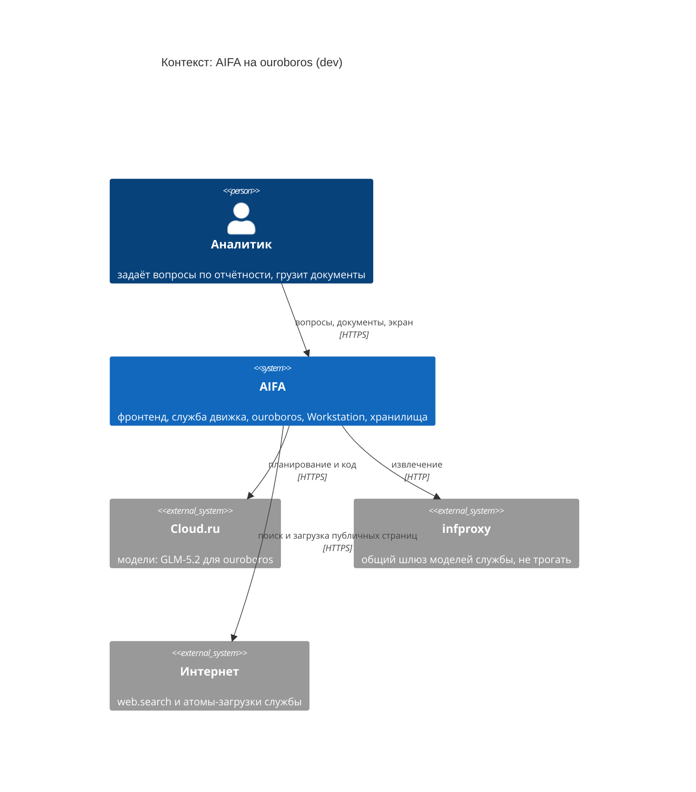
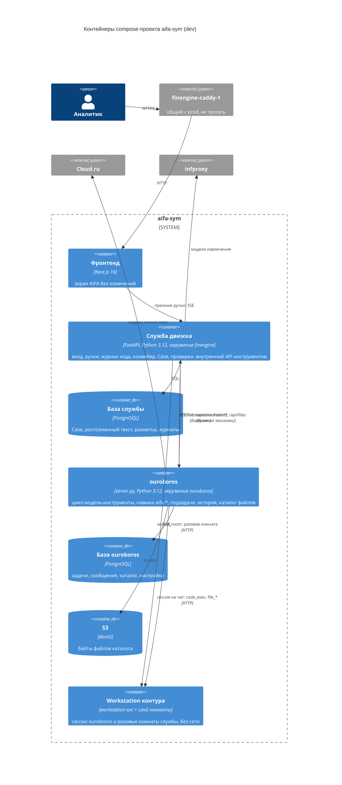
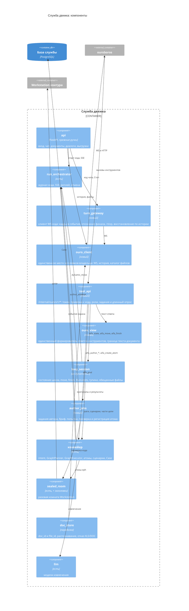
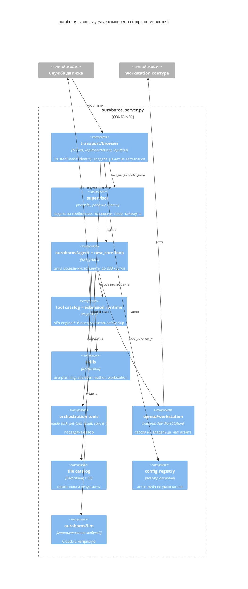
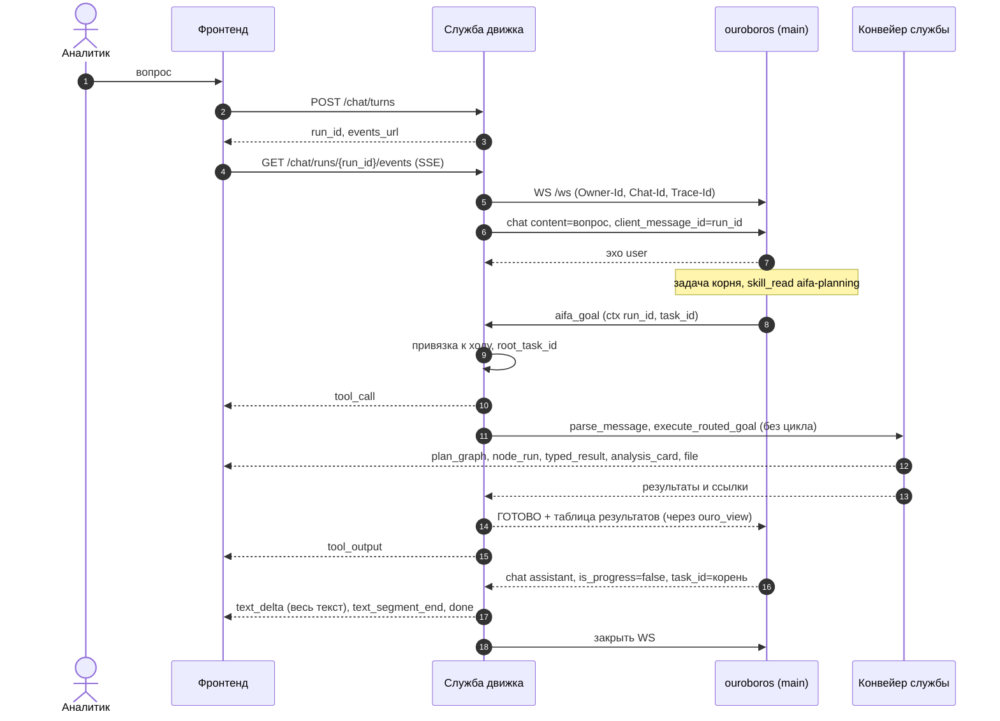
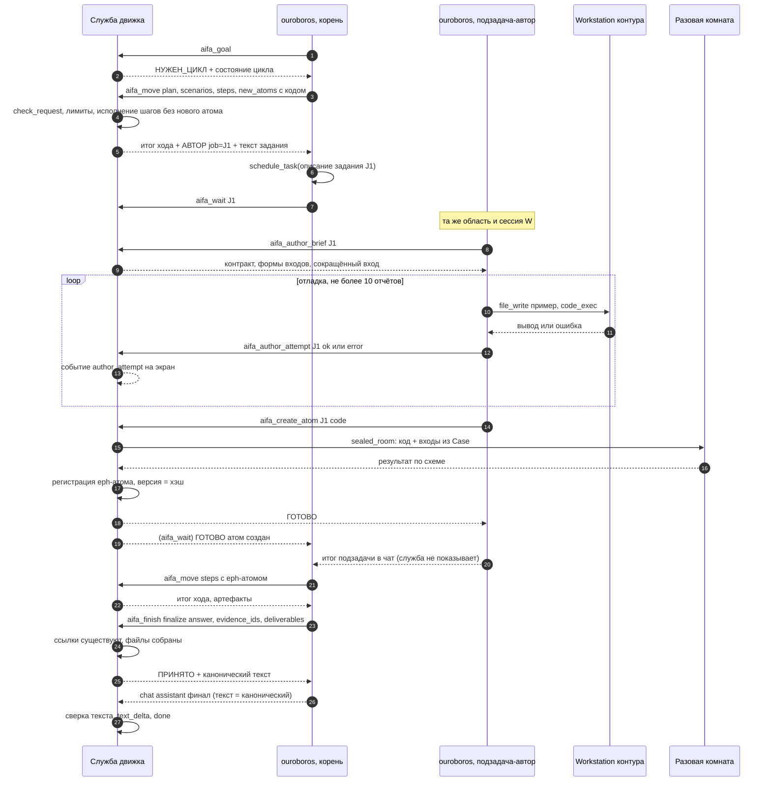

# Низкоуровневая архитектура симбиоза AIFA и ouroboros

Сессия 14.10.2026. Опирается на `../SYMBIOSIS.md` (задача, факты, решения владельца) и
`../PROJECTS_STATE.md` (репозитории, стенд). Решения — `adr/` (указатель — `adr/README.md`),
контракты — `CONTRACTS.md`, автоматические проверки — `FITNESS.md`, правила работы —
`RULES.draft.md`.

**Как читать сессии, которая что-то строит:** §1 → указатель ADR → раздел нужного контракта →
строка своего этапа в §8 → проверки этапа в `FITNESS.md`. Весь документ читать не нужно.

**Как менять:** только новой записью ADR (ADR-0001, проверка F13).

---

## 1. Суть в десяти строках

1. Ouroboros стоит в корне репозитория без единой правки; всё AIFA — в `aifa/`, навыки — в
   `skills/aifa-*` (ADR-0019).
2. Два окружения Python и четыре образа: ouroboros, служба движка, фронтенд, Workstation (ADR-0020).
3. Фронтенд и его события не меняются; служба движка — единственный собеседник фронтенда (ADR-0015).
4. Ход: служба открывает WebSocket браузерного транспорта ouroboros с заголовками владельца и чата,
   `client_message_id` = `run_id`; финальный ответ — непрогрессный кадр корневой задачи (ADR-0021).
5. Ouroboros думает и решает; служба исполняет и проверяет: восемь инструментов `aifa-engine`,
   у каждого правила цикла — код и тест в службе (ADR-0022, ADR-0023).
6. Ouroboros не видит текста документа: оригиналы не прикладываются к сообщениям, инструменты
   чтения файлов выключены, все ответы инструментов идут через один модуль `ouro_view` (ADR-0025).
7. Автор кода — подзадача ouroboros в той же сессии Workstation; служба проверяет код в разовой
   комнате и регистрирует атом (ADR-0008).
8. Тексты чатов и файлы — у ouroboros; `Case`, распознанный текст, журналы — у службы
   (ADR-0011, ADR-0012).
9. Ouroboros настраивается только окружением; набор настроек зафиксирован снимком (ADR-0027).
10. Каждый этап меняет одну переменную и сравнивается с опорной записью поведения AIFA (ADR-0029).

---

## 2. Подход: C4 + ADR + контракты + проверки + опорная запись

Владелец предложил C4 + ADR + автоматические проверки. Я оставляю их и добавляю две опоры,
без которых в этом переносе архитектура держится хуже.

| Опора | Отвечает на | Почему её одной мало |
|---|---|---|
| C4 (Mermaid) | из чего состоит | картинка не ловит нарушений |
| ADR | почему так | запись не мешает написать иначе |
| Автоматические проверки (fitness functions) | что нельзя | держат структуру (импорты, бюджет), но не смысл обмена |
| **Контрактные тесты** (consumer-driven) | как части говорят | — без них C2–C6 — только текст; у нас три независимо меняющихся стороны (фронтенд, служба, ouroboros) и две модели поведения ouroboros, которые подтверждаются только живым тестом (опознание корня, подзадачи) |
| **Опорная запись** (golden master) | что видит пользователь | — единственная проверка, что перенос ничего не потерял; это и есть критерий готовности владельца |

Чем это лучше чистого «C4 + ADR + проверки»: проверки держат то, что видно в коде
(импорты, конфигурация), а самые дорогие поломки симбиоза — на стыке во время исполнения
(финал не тот, подзадача приняла чужой кадр, экран потерял событие). Их ловят только тест
контракта на живом ouroboros с подставной моделью и реплей опорной записи. Подставной сервер модели
(OpenAI-совместимый, отвечает записанными решениями) — ключевой инструмент: он делает ход ouroboros
детерминированным и позволяет гонять полный путь без денег и без сети.

Чего сознательно не делаем: C4 уровня «код», Structurizr DSL, OpenSpec-изменения для симбиоза
(OpenSpec — механизм ouroboros для поведения ouroboros, а мы его поведение не меняем).

---

## 3. Структура единого репозитория

Раскладка — ADR-0019, окружения и образы — ADR-0020.

```text
/                              ouroboros без изменений (корень, пакет ouroboros, uv.lock, scripts/check.sh)
├── skills/
│   ├── aifa-planning/         instruction: SKILL.md (порядок хода, правила из промпта 6.1 плана 34) + references/ (каталог атомов, реестр — генерируются службой при сборке)
│   ├── aifa-atom-author/      instruction: SKILL.md (промпт 7.1 плана 34, работа в Workstation, отчёты)
│   └── aifa-engine/           extension: SKILL.md, plugin.py (тонкий клиент), tests/ (F4, F12)
├── aifa/
│   ├── finengine/             служба: pyproject.toml, uv.lock, src/finengine/, tests/
│   ├── web/                   фронтенд Next.js
│   ├── contracts/             tools.snapshot.json, loop_rules.yaml, tool_names.json, events/*.schema.json, ws/*.json
│   ├── tests/
│   │   ├── architecture/      F1, F2, F7, F9, F11, F12a, F13
│   │   ├── contract/          C1, C2, C4, C6 (живой ouroboros в compose-профиле contract)
│   │   ├── golden/            опорные записи этапа 1 и нормализатор
│   │   └── stub_model/        подставной OpenAI-совместимый сервер модели
│   ├── deploy/dev/            compose.yml, ouroboros.Dockerfile, finengine.Dockerfile, frontend.Dockerfile,
│   │                          workstation/Dockerfile, *.env.example, README.md
│   ├── scripts/check.sh       ворота симбиоза
│   └── CLAUDE.md, AGENTS.md   правила работы (из RULES.draft.md после согласования)
└── aifa-symbiosis/            документация симбиоза (эта папка)
```

**Откуда берётся код AIFA.** Из `Krab_ext/AIFA-CLAW` ветки `feature/Claw-v2-1.0` @ `f4a12fc6`:
`src/` и `tests/` → `aifa/finengine/`, `pyproject.toml` → `aifa/finengine/` (с uv-замком), `web/` →
`aifa/web/`, нужные части `deploy/` → `aifa/deploy/dev/`, `docs/build-plan/34*.md` и
`01-nerushimye-resheniya.md` → `aifa/finengine/docs/`. Корневые заметки AIFA (`Nedodelano.md`,
`План_разработки.md`, выгрузки, мусор сессий) не переносятся. Сохранять ли историю git AIFA —
открытый вопрос (§9).

**Сборка.**

| Что | Команда | Окружение |
|---|---|---|
| ouroboros | `uv sync --frozen` | корень |
| служба | `uv sync --frozen --project aifa/finengine` | `aifa/finengine/.venv` |
| фронтенд | `npm ci` в `aifa/web` | Node |
| ворота ouroboros | `./scripts/check.sh` | как есть |
| ворота симбиоза | `aifa/scripts/check.sh` = ворота ouroboros + ruff/mypy/pytest службы + `aifa/tests` + `npm test` | оба |
| образы dev | `docker compose -p aifa-sym -f aifa/deploy/dev/compose.yml build` | — |

**Как жить рядом с ouroboros.** Не правим ни одного его файла (F1). Его правила действуют на его
пути: при работе с `skills/aifa-*` читаются `.rules/skills.md` и инварианты (resolver
`scripts/resolve_rules.py` выдаёт правило по пути `skills/**`). Его ворота — часть наших. Его
`BACKLOG.md`, `HANDOFF.md`, OpenSpec не ведём: наши решения — ADR, незавершённое —
`PROJECTS_STATE.md`. Корпоративная ветка подтягивается слиянием из `corp` (ADR-0019).

---

## 4. Диаграммы C4

### 4.1. Контекст



### 4.2. Контейнеры



Где поднимать PostgreSQL и S3 на dev (новые контейнеры или новые базы в имеющихся) — открытый
вопрос этапа 0 (§9). Старый AIFA (`finengine-*`, `openclaw-dev`, `workstation-svc`) работает рядом
до этапа 6.

### 4.3. Компоненты службы движка



### 4.4. Компоненты ouroboros, которыми пользуемся (без изменений)



Отключены окружением (ADR-0027): A2A, Dialogs, память, расписания, веб-поиск и браузер ouroboros,
чтение вложений и диска, картинки, отправка файлов, навыки поставки кроме `workstation`.

---

## 5. Ход стандартным путём



Если `aifa_goal` дольше 240 с — ответ `ЖДИ job=…` и вызовы `aifa_wait` до итога; экран получает
события конвейера всё это время.

---

## 6. Ход через цикл с автором кода (этап 4 и далее)



Неудачная проверка кода: `aifa_create_atom` → `ОТКАЗ` с хвостом ошибки и остатком попыток; после
трёх — задание закрыто, `aifa_wait` корня возвращает отказ, планировщик меняет путь.

---

## 7. Где держатся гарантии

| Гарантия | Держит | Проверка |
|---|---|---|
| Числа только из доказательной базы | инструменты цикла отказывают без `НУЖЕН_ЦИКЛ`; `aifa_finish` проверяет ссылки и файлы | C3.1, F8 |
| Ouroboros не видит текста документа | нет вложений в кадрах; инструменты чтения выключены; ответы — только `ouro_view` | F3, F6, F9 |
| Код, видящий `Case`, без сети | исполнение только в разовой комнате W | C5.2 |
| Один ход — один владелец | заголовки владельца ставит только `ouro_client`; привязка вызова к ходу | F12, C3.0 |
| Экран не меняется | события пишут прежние эмиттеры; реплей опорной записи | F5 |
| Ядро ouroboros не меняется | все правки в `aifa/`, `aifa-symbiosis/`, `skills/aifa-*` | F1 |
| Цикл конечен | `RunLimits` в `loop_session`; 3 проверки автора; срок задания; `OUROBOROS_HARD_TIMEOUT_SEC` | C3.1, C4.3 |

---

## 8. Этапы 0–6: шаг → чем проверяется

Состав этапов — `SYMBIOSIS.md` §6; порядок внутри 2–4 — ADR-0029. Каждый шаг — коммит с тестом,
который до шага падал (правило AIFA «тесты до кода»).

### Этап 0. Репозиторий, каркас проверок, ouroboros на dev

| Шаг | Чем проверяется |
|---|---|
| 0.1 Ветка своего репозитория от `release/1.5.1` @ `ec596862`, тег `upstream/ouroboros-ec596862`; удалённый `corp` только на чтение; новый удалённый владельца — с его разрешения, без push | `git describe`, тег на месте |
| 0.2 Перенос кода AIFA в `aifa/` (§3), без изменений содержимого | `aifa/finengine`: тесты службы зелёные относительно базовой линии AIFA (известные красные записаны); `npm test` фронтенда |
| 0.3 Каркас проверок F1, F2, F9, F11, F13 и `aifa/scripts/check.sh` | каждая проверка падает на подложенном нарушении и зелёная на дереве |
| 0.4 `aifa/deploy/dev/`: образы ouroboros, Workstation (база + слой комнаты); env.example | сборка локально или на dev; F9 зелёная |
| 0.5 Чистка диска dev (только своё и висячее: `docker image prune`, кэш сборки, старые `~/p1-backup-*` — по списку, согласованному с владельцем) | `df -h /` — свободно ≥ 8 ГБ; `docker ps` prod до/после совпадает |
| 0.6 Подъём `aifa-sym`: ouroboros (один процесс, `OUROBOROS_MULTIUSER=true`), PostgreSQL, S3, Workstation | `/ready` 200; WS-рукопожатие с заголовками изнутри сети, реплика «привет» получает ответ модели; `workstation_connect` + `code_exec` из ouroboros; разовая комната `sealed_room` (C5.2) |
| 0.7 Проверки этапа 0 с живым экземпляром: как расширения получают настройки (ADR-0027), реальный список инструментов для `OUROBOROS_DISABLED_TOOLS` | записи в ADR-0027 обновлены новой записью, если вывод расходится |

### Этап 1. Опорная запись

| Шаг | Чем проверяется |
|---|---|
| 1.1 Нормализатор потока событий и сравнение (`aifa/tests/golden/`) | два прогона одного сценария на нынешнем dev AIFA сравниваются как равные; список нестабильных полей записан |
| 1.2 Запись S0–S5, А1–А8 на нынешнем dev AIFA (поток SSE, финальный текст, `Case`, файлы) | записи в `aifa/tests/golden/`; F5 (а) — схемы событий из записей |
| 1.3 Подставной сервер модели и формат «записанных решений» | тест: ouroboros с подставной моделью проходит ход «привет» детерминированно |

### Этап 2. Служба говорит с ouroboros; один инструмент «выполнить цель»

| Шаг | Чем проверяется |
|---|---|
| 2.1 `ouro_client` и `turn_gateway` (§2 `CONTRACTS.md`) | C2.1–C2.8 на живом ouroboros + подставной модели |
| 2.2 `tool_api` (токен, привязка, роли, задания, длинный опрос) + `ouro_view` | C3.0, C3.2, C3.4; F3 (а) |
| 2.3 Навык `aifa-engine` с `aifa_goal`, `aifa_wait`; навык `aifa-planning` — минимальный (всегда `aifa_goal`, ответ по результатам) | F4, F12 (б); C3.3 |
| 2.4 При сбое стандартного пути служба гонит нынешний `DynamicRun` внутри `aifa_goal` | тесты `tests/dynamic_run` зелёные без изменений |
| 2.5 Файлы — каталог ouroboros; история — из ouroboros; XLS/DOC — отказ | C6.1–C6.4, C1.3, C1.4 |
| 2.6 Удалить `mcp` из службы | F11 |
| 2.7 Сравнение с опорной записью | F5 (б) на S0–S5; различия — только разрешённые ADR (`thinking`, XLS/DOC) |

### Этап 3. Навык планирования: ходы цикла — инструментами

| Шаг | Чем проверяется |
|---|---|
| 3.1 `loop_session` из `DynamicRun` (ADR-0023); `aifa_state`, `aifa_move`, `aifa_finish`; автор пока внутри службы | перенос `tests/dynamic_run` на API инструментов; C3.1 |
| 3.2 Карта правил `loop_rules.yaml` | F8 зелёная — у каждого правила тест |
| 3.3 Навык `aifa-planning`: промпт 6.1 плана 34 → `SKILL.md` + `references/` (каталог атомов, реестр — генерируются службой) | реплей записанных решений планировщика из опорной записи через ouroboros + подставную модель даёт те же ходы |
| 3.4 Живое сравнение на А1–А8 (GLM-5.2) | F5 (б); число расхождений финального текста с каноническим (ADR-0024) записано |

### Этап 4. Навык написания кода: подзадача-автор

| Шаг | Чем проверяется |
|---|---|
| 4.1 `author_jobs`; `aifa_author_brief`, `aifa_author_attempt`, `aifa_create_atom`; `aifa_move` отвечает `АВТОР job=…` | C4.1–C4.4 |
| 4.2 Навык `aifa-atom-author` (промпт 7.1 плана 34 + работа в Workstation + отчёты) | реплей записанных ответов автора: атом принят со второй попытки после ошибки |
| 4.3 Удалить `atom_author.py` и модель автора из службы | F2; тесты службы зелёные |
| 4.4 Живой прогон с файлом (xlsx на двух листах с формулами) | файл в каталоге ouroboros, карточка и лента «Планировщик и автор» на экране; F3 (б) с автором |

### Этап 5. Чистка

| Шаг | Чем проверяется |
|---|---|
| 5.1 Удалить диспетчер OpenClaw, плагины гейтвея, навыки станции, мост станции, MCP-сервер, ведущий драйвер `DynamicRun.run`, `station_turn`, `internal_tools` | F10 включена и зелёная; ворота симбиоза зелёные |

### Этап 6. Приёмка

| Шаг | Чем проверяется |
|---|---|
| 6.1 Наборы S0–S5, А1–А8 на новой системе | F5 (б) против опорной записи; разрешённые различия — только по ADR |
| 6.2 Экран глазами (нужна QA-учётка — открытый пункт AIFA) | чек-лист экрана: граф, план, лента ходов, карточки, файлы |
| 6.3 Снять путь через OpenClaw на dev (только `openclaw-dev` и связанные dev-маршруты; prod не трогать) | `docker ps` prod до/после совпадает; dev AIFA работает через `aifa-sym` |

---

## 9. Открытые вопросы

| № | Вопрос | Когда нужен ответ | Предложение |
|---|---|---|---|
| О1 | Сохранять ли историю git AIFA при переносе в `aifa/` | этап 0.2 | сохранить: `git filter-repo` по нужным путям + слияние с `--allow-unrelated-histories` в `aifa/` — сохраняет `blame` 376 коммитов месяца |
| О2 | Где на dev PostgreSQL и S3 для ouroboros и базы службы | этап 0.6 | новые контейнеры в `aifa-sym` (изоляция от старого AIFA, который работает параллельно); память: ~5,9 ГБ всего, ~3,3 ГБ свободно — мерить после подъёма |
| О3 | Кнопки с `pinned_tool` (детерминированный запуск без модели) — через ouroboros или внутри службы | этап 2.1 | внутри службы, как сейчас; в историю ouroboros такие ходы не попадают — описать в ADR после ответа |
| О4 | Событие `usage`: показывать ли расход моделей ouroboros | этап 2 | показывать только расход службы; расход ouroboros — из его журнала, отдельной задачей |
| О5 | Новый удалённый репозиторий владельца (адрес, видимость) и правила веток/коммитов (хук `commit-msg` ouroboros требует Jira+GitLab на `feature/*`) | этап 0.1 | ветки `sym/*` — хук не срабатывает; номера задач — по желанию владельца |
| О6 | Как расширение получает адрес службы и токен | этап 0.7 | см. ADR-0027 |
| О7 | Живые проверки ADR-0021 (финальный кадр корня несёт `task_id`; уведомления подзадачи — без него) | этап 2.1 | C2.3–C2.4; при расхождении — новая ADR с другим правилом опознания |
