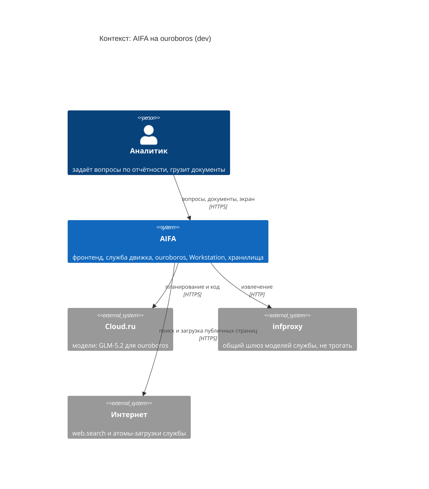
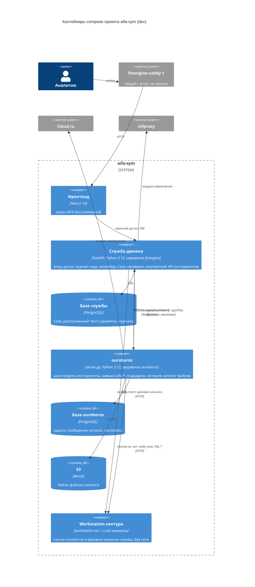
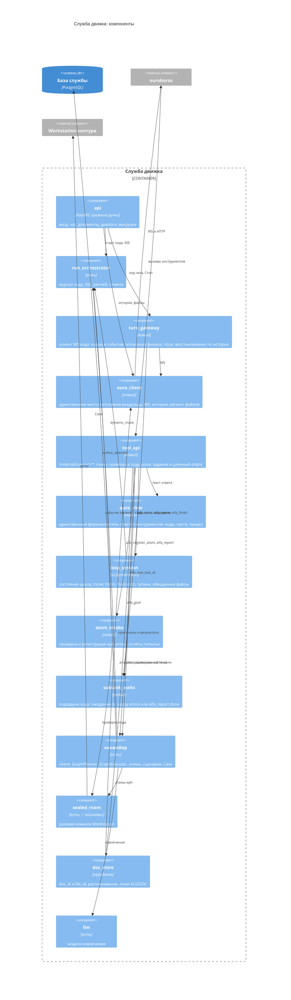
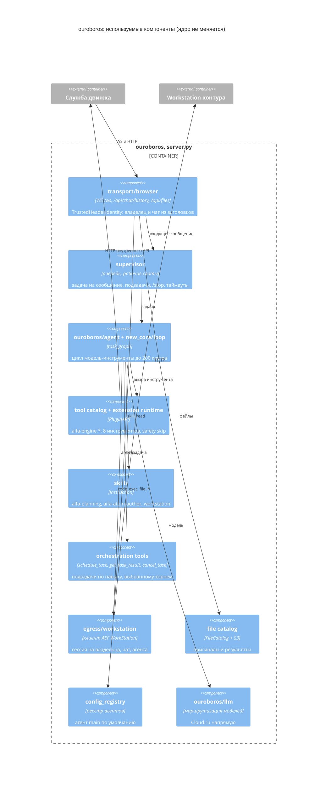
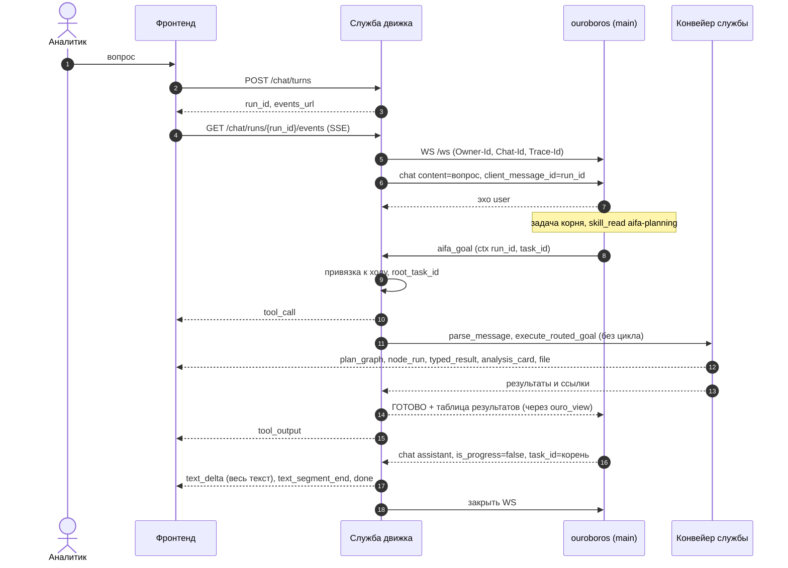
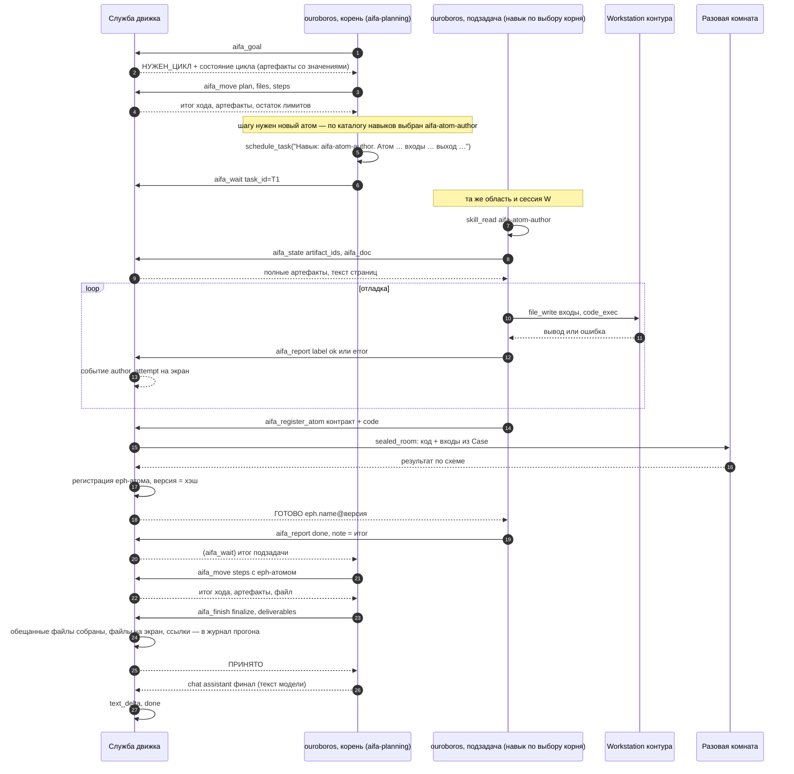

# Низкоуровневая архитектура симбиоза AIFA и ouroboros

Сессия 14.10.2026. Опирается на `../SYMBIOSIS.md` (задача, факты, решения владельца) и
`../PROJECTS_STATE.md` (репозитории, стенд). Решения — `adr/` (указатель — `adr/README.md`),
контракты — `CONTRACTS.md`, автоматические проверки — `FITNESS.md`, правила работы —
`RULES.draft.md`.

**Как читать сессии, которая что-то строит:** §1 → указатель ADR → раздел нужного контракта →
строка своего этапа в §8 → проверки этапа в `FITNESS.md`. Весь документ читать не нужно.

**Как менять:** только новой записью ADR (ADR-0001, проверка F13).

---

## 1. Суть в десяти строках

1. Ouroboros стоит в корне репозитория без единой правки; всё AIFA — в `aifa/`, навыки — в
   `skills/aifa-*` (ADR-0019).
2. Два окружения Python и четыре образа: ouroboros, служба движка, фронтенд, Workstation (ADR-0020).
3. Фронтенд и его события не меняются; служба движка — единственный собеседник фронтенда (ADR-0015).
4. Ход: служба открывает WebSocket браузерного транспорта ouroboros с заголовками владельца и чата,
   `client_message_id` = `run_id`; финальный ответ — непрогрессный кадр корневой задачи (ADR-0021).
5. Ouroboros думает и решает; служба исполняет граф и хранит данные: восемь инструментов
   `aifa-engine`, у каждого правила цикла — код и тест в службе (ADR-0023, ADR-0042).
6. На время MVP ouroboros видит распознанный текст документов и все артефакты — только через
   инструменты `aifa-engine`; числа не обязаны идти из доказательной базы (ADR-0040).
7. Навык подзадачи выбирает планировщик; служба навыков не знает и даёт всем подзадачам одни и те
   же операции; новый атом проверяется в разовой комнате и регистрируется службой (ADR-0041).
8. Тексты чатов и файлы — у ouroboros; `Case`, распознанный текст, журналы — у службы
   (ADR-0011, ADR-0012).
9. Ouroboros настраивается только окружением; набор настроек зафиксирован снимком (ADR-0027).
10. Каждый этап меняет одну переменную (ADR-0029).

---

## 2. Подход: C4 + ADR + контракты + проверки

Владелец предложил C4 + ADR + автоматические проверки. Я оставляю их и добавляю опору,
без которой в этом переносе архитектура держится хуже.

| Опора | Отвечает на | Почему её одной мало |
|---|---|---|
| C4 (Mermaid) | из чего состоит | картинка не ловит нарушений |
| ADR | почему так | запись не мешает написать иначе |
| Автоматические проверки (fitness functions) | что нельзя | держат структуру (импорты, бюджет), но не смысл обмена |
| **Контрактные тесты** (consumer-driven) | как части говорят | — без них C2–C6 — только текст; у нас три независимо меняющихся стороны (фронтенд, служба, ouroboros) и две модели поведения ouroboros, которые подтверждаются только живым тестом (опознание корня, подзадачи) |

Чем это лучше чистого «C4 + ADR + проверки»: проверки держат то, что видно в коде
(импорты, конфигурация), а самые дорогие поломки симбиоза — на стыке во время исполнения
(финал не тот, подзадача приняла чужой кадр, экран потерял событие). Их ловит только тест
контракта на живом ouroboros с подставной моделью. Подставной сервер модели
(OpenAI-совместимый, отвечает записанными решениями) — ключевой инструмент: он делает ход ouroboros
детерминированным и позволяет гонять полный путь без денег и без сети.

Чего сознательно не делаем: C4 уровня «код», Structurizr DSL, OpenSpec-изменения для симбиоза
(OpenSpec — механизм ouroboros для поведения ouroboros, а мы его поведение не меняем).

---

## 3. Структура единого репозитория

Раскладка — ADR-0019, окружения и образы — ADR-0020.

```text
/                              ouroboros без изменений (корень, пакет ouroboros, uv.lock, scripts/check.sh)
├── skills/
│   ├── aifa-planning/         instruction: SKILL.md (порядок хода, правила из промпта 6.1 плана 34) + references/ (каталог атомов, реестр — генерируются службой при сборке)
│   ├── aifa-atom-author/      instruction: SKILL.md (промпт 7.1 плана 34, работа в Workstation, отчёты)
│   └── aifa-engine/           extension: SKILL.md, plugin.py (тонкий клиент), tests/ (F4, F12)
├── aifa/
│   ├── finengine/             служба: pyproject.toml, uv.lock, src/finengine/, tests/, docs/;
│   │                          временно (ADR-0032): station-skills/, agent-workspace/ — до шага 19; benchmarks/;
│   │                          deploy/ (ADR-0034): tools_whitelist.yaml, certs/ — копируются в образ службы
│   ├── web/                   фронтенд Next.js
│   ├── contracts/             tools.snapshot.json, loop_rules.yaml, tool_names.json, ws/*.json,
│   │                          dev_config.snapshot.json (снимок F9, ADR-0034)
│   ├── tests/
│   │   ├── architecture/      F1, F2, F7, F9, F11, F12a, F13
│   │   ├── contract/          C1, C2, C4, C6 (живой ouroboros в compose-профиле contract)
│   │   ├── golden/            записывающий клиент, нормализатор и сравнение (шаг 05)
│   │   └── stub_model/        подставной OpenAI-совместимый сервер модели
│   ├── deploy/dev/            compose.yml, ouroboros.Dockerfile, finengine.Dockerfile, frontend.Dockerfile,
│   │                          workstation/Dockerfile, *.env.example, README.md
│   ├── scripts/check.sh       ворота симбиоза
│   └── CLAUDE.md, AGENTS.md   правила работы (из RULES.draft.md после согласования)
└── aifa-symbiosis/            документация симбиоза (эта папка)
```

**Откуда берётся код AIFA.** Из `Krab_ext/AIFA-CLAW` ветки `feature/Claw-v2-1.0` @ `f4a12fc6`:
`src/` и `tests/` → `aifa/finengine/`, `pyproject.toml` → `aifa/finengine/` (с uv-замком), `web/` →
`aifa/web/`, нужные части `deploy/` → `aifa/deploy/dev/`, `docs/build-plan/34*.md` и
`01-nerushimye-resheniya.md` → `aifa/finengine/docs/`; `station-skills/`, `agent-workspace/`,
`benchmarks/` (без LFS-эталонов) → `aifa/finengine/` (ADR-0032, нужны тестам службы). Корневые
заметки AIFA (`Nedodelano.md`, `План_разработки.md`, выгрузки, мусор сессий) не переносятся.
Перенос — снимком из коммита
`f4a12fc6` без истории git; история остаётся в исходном репозитории (ADR-0031).

**Сборка.**

| Что | Команда | Окружение |
|---|---|---|
| ouroboros | `uv sync --frozen` | корень |
| служба | `uv sync --frozen --project aifa/finengine` | `aifa/finengine/.venv` |
| фронтенд | `npm ci` в `aifa/web` | Node |
| ворота ouroboros | `./scripts/check.sh` | как есть |
| ворота симбиоза | `aifa/scripts/check.sh` = ворота ouroboros + ruff/mypy/pytest службы + `aifa/tests` + `npm test` | оба |
| образы dev | `docker compose -p aifa-sym -f aifa/deploy/dev/compose.yml build` | — |

**Как жить рядом с ouroboros.** Не правим ни одного его файла (F1). Его правила действуют на его
пути: при работе с `skills/aifa-*` читаются `.rules/skills.md` и инварианты (resolver
`scripts/resolve_rules.py` выдаёт правило по пути `skills/**`). Его ворота — часть наших. Его
`BACKLOG.md`, `HANDOFF.md`, OpenSpec не ведём: наши решения — ADR, незавершённое —
`PROJECTS_STATE.md`. Репозиторий — `Rasiksss/ouroboros_external`, основная ветка `dev`, база
ouroboros — снимок `17b3f93` (тег `base/ouroboros-1.5.1`); корпоративной истории и удалённого нет,
обновление ouroboros — только новым снимком по ADR (ADR-0030).

---

## 4. Диаграммы C4

### 4.1. Контекст



### 4.2. Контейнеры



Где поднимать PostgreSQL и S3 на dev (новые контейнеры или новые базы в имеющихся) — открытый
вопрос этапа 0 (§9). Старый AIFA (`finengine-*`, `openclaw-dev`, `workstation-svc`) работает рядом
до этапа 6.

### 4.3. Компоненты службы движка



### 4.4. Компоненты ouroboros, которыми пользуемся (без изменений)



Отключены окружением (ADR-0027): A2A, Dialogs, память, расписания, веб-поиск и браузер ouroboros,
чтение вложений и диска, картинки, отправка файлов, навыки поставки кроме `workstation`.

---

## 5. Ход стандартным путём



Если `aifa_goal` дольше 240 с — ответ `ЖДИ job=…` и вызовы `aifa_wait` до итога; экран получает
события конвейера всё это время.

---

## 6. Ход через цикл с подзадачей (этап 4 и далее)

Навык подзадачи выбирает корень (ADR-0041); пример — автор кода.



Корень ждёт подзадачу, пока она работает: запрос `schedule_task` уходит supervisor'у в конце вызова, а не с результатом run (ADR-0052).

Неудачная регистрация: `aifa_register_atom` → `ОТКАЗ` с хвостом ошибки и остатком попыток;
подзадача правит и сдаёт снова; после трёх неудач на имя — `лимит_попыток`, подзадача сообщает итог,
планировщик меняет путь. Другие навыки (ресерчер, визуализатор) идут тем же потоком: навык выбирает
планировщик, операции службы те же.

---

## 7. Где держатся гарантии

| Гарантия | Держит | Проверка |
|---|---|---|
| ~~Числа только из доказательной базы~~ — снята на MVP (ADR-0040); ссылки `aifa_finish` пишутся в журнал прогона для замера | `aifa_finish` | C3.7 |
| ~~Ouroboros не видит текста документа~~ — снята на MVP (ADR-0040); документ приходит только инструментом `aifa_doc`, без вложений в кадрах | `aifa_doc`, клиент хода | C3.6, F6 |
| Код, видящий `Case`, без сети | атомы графа и проверка регистрации — только в разовой комнате W; данные `Case` и текст документа уходят и в сессию W чата ouroboros — она тоже без сети (ADR-0043 п. 11) | C5.2, C4.3, C4.2 (живой) |
| Один ход — один владелец | заголовки владельца ставит только `ouro_client`; привязка вызова к ходу | F12, C3.0 |
| Экран не меняется | события пишут прежние эмиттеры; общие SSE-фикстуры службы и фронтенда (ADR-0045) | C1.2 |
| Ядро ouroboros не меняется | все правки в `aifa/`, `aifa-symbiosis/`, `skills/aifa-*` | F1 |
| Цикл конечен | `RunLimits` в `loop_session`; 3 неудачные регистрации имени за ход цикла; срок подзадачи в `aifa_wait` и время цикла (ADR-0043 п. 3); очередь изменяющих вызовов; пределы подзадач ouroboros; `OUROBOROS_HARD_TIMEOUT_SEC` | C3.1, C3.8, C4.3, C4.9 |
| Служба не знает навыков | навык называет задание планировщика; операции службы общие | C4.7 |

---

## 8. Этапы 0–6: шаг → чем проверяется

Состав этапов — `SYMBIOSIS.md` §6; порядок внутри 2–4 — ADR-0029. Каждый шаг — коммит с тестом,
который до шага падал (правило AIFA «тесты до кода»).

### Этап 0. Репозиторий, каркас проверок, ouroboros на dev

| Шаг | Чем проверяется |
|---|---|
| 0.1 Тег `base/ouroboros-1.5.1` на `17b3f93` (`dev`); ветка шага `sym/01-…` от `dev`; push — только с разрешения владельца (ADR-0030) | `git rev-parse base/ouroboros-1.5.1` = `17b3f93…` |
| 0.2 Перенос кода AIFA в `aifa/` (§3), без изменений содержимого | `aifa/finengine`: тесты службы зелёные относительно базовой линии AIFA (известные красные записаны); `npm test` фронтенда |
| 0.3 Каркас проверок F1, F2, F9, F11, F13 и `aifa/scripts/check.sh` | каждая проверка падает на подложенном нарушении и зелёная на дереве |
| 0.4 `aifa/deploy/dev/`: образы ouroboros, Workstation (база + слой комнаты); env.example | сборка локально или на dev; F9 зелёная |
| 0.5 Чистка диска dev (только своё и висячее: `docker image prune`, кэш сборки, старые `~/p1-backup-*` — по списку, согласованному с владельцем) | `df -h /` — свободно ≥ 8 ГБ; `docker ps` prod до/после совпадает |
| 0.6 Подъём `aifa-sym`: ouroboros (один процесс, `OUROBOROS_MULTIUSER=true`), PostgreSQL, S3, Workstation | `/ready` 200; WS-рукопожатие с заголовками изнутри сети, реплика «привет» получает ответ модели; `workstation_connect` + `code_exec` из ouroboros; разовая комната `sealed_room` (C5.2) |
| 0.7 Проверки этапа 0 с живым экземпляром: как расширения получают настройки (ADR-0027), реальный список инструментов для `OUROBOROS_DISABLED_TOOLS` | записи в ADR-0027 обновлены новой записью, если вывод расходится |

### Этап 1. Нормализатор и подставной сервер модели

| Шаг | Чем проверяется |
|---|---|
| 1.1 Нормализатор потока событий и сравнение (`aifa/tests/golden/`) | два прогона одного сценария на нынешнем dev AIFA сравниваются как равные; список нестабильных полей записан |
| 1.2 Подставной сервер модели и формат «записанных решений» | тест: ouroboros с подставной моделью проходит ход «привет» детерминированно |

### Этап 2. Служба говорит с ouroboros; один инструмент «выполнить цель»

| Шаг | Чем проверяется |
|---|---|
| 2.1 `ouro_client` и `turn_gateway` (§2 `CONTRACTS.md`) | C2.1–C2.8 на живом ouroboros + подставной модели |
| 2.2 `tool_api` (токен, привязка, роли, задания, длинный опрос) + `ouro_view` | C3.0, C3.2, C3.4 |
| 2.3 Навык `aifa-engine` с `aifa_goal`, `aifa_wait`; навык `aifa-planning` — минимальный (всегда `aifa_goal`, ответ по результатам) | F4, F12 (б); C3.3 |
| 2.4 При сбое стандартного пути служба гонит нынешний `DynamicRun` внутри `aifa_goal` | тесты `tests/dynamic_run` зелёные без изменений |
| 2.5 Файлы — каталог ouroboros; история — из ouroboros; XLS/DOC — отказ | C6.1–C6.4, C1.3, C1.4 |
| 2.6 Удалить `mcp` из службы | F11 |
| 2.7 Наборы S0–S5 на новой системе | итог каждого сценария совпадает с «Ожиданием» в `34-status.md` (часть 12) |

### Этап 3. Навык планирования: ходы цикла — инструментами

| Шаг | Чем проверяется |
|---|---|
| 3.1 `loop_session` из `DynamicRun` (ADR-0023); `aifa_state`, `aifa_doc`, `aifa_move`, `aifa_finish`; очередь изменяющих вызовов; цикл — только по `НУЖЕН_ЦИКЛ`; правила цикла не меняются; автор пока внутри службы | перенос `tests/dynamic_run` на API инструментов; C3.1, C3.6, C3.8, C3.9 |
| 3.1a Снятие правил завершения по ADR-0040 (ссылки, опровергнутые находки, канонический текст) при `loop_driver=engine` | C3.7 |
| 3.2 Карта правил `loop_rules.yaml` | F8 зелёная — у каждого правила тест |
| 3.3 Навык `aifa-planning`: промпт 6.1 плана 34 → `SKILL.md` + `references/` (каталог атомов, реестр — генерируются службой) | подставная модель с заданными ответами планировщика через ouroboros даёт ожидаемые ходы |
| 3.4 Живой прогон А1–А8 (GLM-5.2) | итог каждого запроса совпадает с «Ожиданием» в `34-status.md` (часть 15); доля ответов со ссылками на `Case` (замер ADR-0040) записана |

### Этап 4. Навык написания кода: подзадача-автор

| Шаг | Чем проверяется |
|---|---|
| 4.1 `atom_intake` и `subtask_waits`: `aifa_register_atom`, `aifa_report`, `aifa_wait(task_id)`; автор пока в службе — `atom_author.py` сдаёт код через тот же `atom_intake` | C4.1, C4.3–C4.9; C3.0; F9 (`schedule_task` включён, ADR-0043 п. 1) |
| 4.2 Навык `aifa-atom-author` (промпт 7.1 плана 34 + работа в Workstation + отчёты); раздел «Делегирование» навыка `aifa-planning` (выбор навыка, текст задания, ожидание) | подставная модель с заданными ответами: корень выбирает навык, атом принят со второй попытки после ошибки |
| 4.3 Удалить `atom_author.py`, модель автора и атом с кодом в `new_atoms` `aifa_move` | F2; тесты службы зелёные |
| 4.4 Живой прогон с файлом (xlsx на двух листах с формулами) | файл в каталоге ouroboros, карточка и лента «Планировщик и автор» на экране |

### Этап 5. Чистка

| Шаг | Чем проверяется |
|---|---|
| 5.1 Удалить диспетчер OpenClaw, плагины гейтвея, навыки станции, мост станции, MCP-сервер, ведущий драйвер `DynamicRun.run`, `station_turn`, `internal_tools` | F10 включена и зелёная; ворота симбиоза зелёные |

### Этап 6. Приёмка

| Шаг | Чем проверяется |
|---|---|
| 6.1 Наборы S0–S5, А1–А8 на новой системе | итог каждого запроса совпадает с «Ожиданием» в `34-status.md` (части 12 и 15) |
| 6.2 Снять путь через OpenClaw на dev (только `openclaw-dev` и связанные dev-маршруты; prod не трогать) | `docker ps` prod до/после совпадает; dev AIFA работает через `aifa-sym` |

---

## 9. Открытые вопросы

| № | Вопрос | Когда нужен ответ | Предложение |
|---|---|---|---|
| О1 | ~~Сохранять ли историю git AIFA~~ — **решено** ADR-0031: снимок `f4a12fc6` без истории | — | — |
| О2 | Где на dev PostgreSQL и S3 для ouroboros и базы службы | этап 0.6 | новые контейнеры в `aifa-sym` (изоляция от старого AIFA, который работает параллельно); память: ~5,9 ГБ всего, ~3,3 ГБ свободно — мерить после подъёма |
| О3 | Кнопки с `pinned_tool` (детерминированный запуск без модели) — через ouroboros или внутри службы | этап 2.1 | **решено** (владелец, 18.10.2026, ADR-0047 п. 2): внутри службы, как сейчас; в историю ouroboros такие ходы не попадают |
| О4 | Событие `usage`: показывать ли расход моделей ouroboros | этап 2 | **решено** (владелец, 18.10.2026, ADR-0047 п. 3): только расход службы; расход ouroboros — из его журнала, отдельной задачей |
| О5 | ~~Удалённый репозиторий и ветки~~ — **решено** ADR-0030: `Rasiksss/ouroboros_external`, ветка `dev`, ветки шагов `sym/NN-*` | — | — |
| О6 | Как расширение получает адрес службы и токен | этап 0.7 | см. ADR-0027 |
| О7 | Живые проверки ADR-0021 (финальный кадр корня несёт `task_id`; уведомления подзадачи — без него; итог подзадачи несёт её `task_id` — ADR-0041) | этап 2.1 | C2.3–C2.4; при расхождении — новая ADR с другим правилом опознания |
