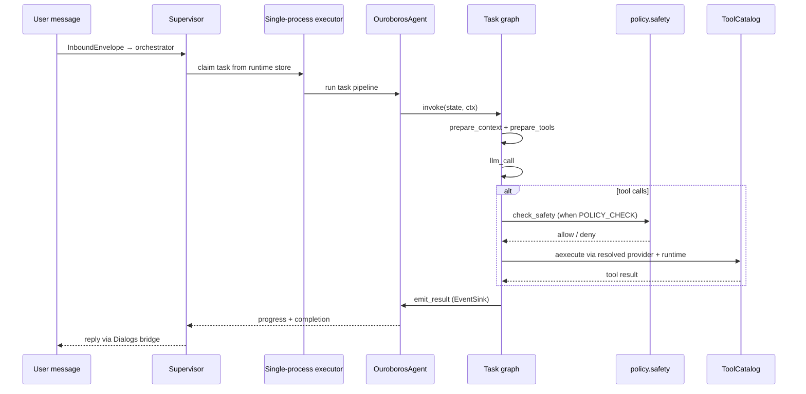

# Ouroboros — Architecture (headless runtime)

This document is the **current operational map** of the headless Ouroboros tree: package layout, data flows, HTTP surface, policy boundaries, and rationale for non-obvious guards. It is not a changelog.

**Target architecture:** production hardening, SberChat-first ingress, Secman, minimal sandbox, and audit are specified in the wiki: [Solution Architecture](https://gitlab.k8s.genai.int/gen-ai/fusion_team/backend/ouroboros/-/wikis/Solution-Архитектура-As-Is). Section [Gap vs target](#gap-vs-target-architecture) below tracks what this branch implements today.

---

## Runtime profile (this branch)

| Aspect | Current behavior |
|--------|------------------|
| Deploy env | `OUROBOROS_ENV=production` (default) or `development` for local work |
| Entry | `python server.py` (Docker: `ENTRYPOINT` on port 8080) |
| User ingress / outbound | **Dialogs / SberChat** via `supervisor/messaging` (gRPC provider) |
| HTTP surface | Default: health + `/api/health` only (`gateway/router.py`). Optional browser ingress mounts extra routes when `BROWSER_INGRESS_ENABLED=true` |
| Configuration | **Environment + in-process `AppSettings`**; no `/api/settings`, no `settings.json` persistence in production |
| LLM provider | GigaChat B2Bank by default (`gigachat-b2bank::...` with mTLS cert paths); Cloud.ru Foundation Models via `cloudru::...` |
| Self-modification | **Removed** from tool surface: no `repo_write`, `repo_commit`, `run_shell`, git tools |
| Legacy browser UI | **`web/` removed** from this repo; no settings editor or `host_service` sidecar. Browser-compatible HTTP/WS ingress is opt-in via `BROWSER_INGRESS_ENABLED` |
| Skill trust | `OUROBOROS_REPO_DIR/skills` is part of the trusted, read-only distribution; manifest capabilities/settings are auto-authorized |
| Marketplace install | **Removed** from HTTP routes; bundled skills under `skills/` only |

---

## High-level diagram (as implemented)

```mermaid
flowchart TB
    owner[Owner in Dialogs / SberChat]
    owner --> dialogs[Dialogs gRPC provider]
    dialogs --> bridge[LocalChatBridge / message_bus]
    bridge --> server[server.py Starlette + uvicorn]
    server --> sup[SupervisorLoop in supervisor/runtime.py]
    sup --> orch[TaskOrchestrator]
    orch --> store[Runtime DB store]
    sup --> executor[TaskExecutor]
    executor --> agent[OuroborosAgent]
    agent --> graph[Task graph on new_core engine]
    graph --> catalog[ToolCatalog: ordered providers]
    catalog --> tools[Built-in tools + skills + extensions + MCP]
    agent --> memory[storage/memory + task_results]
    server --> gw[gateway: health]
    edge[Operator / probe] --> gw
```

### Target diagram (wiki — converging)

The wiki describes the production target: **SberChat adapter → identity gate → orchestrator → policy engine → sandbox → Secman / resource gateways → audit**. See the wiki flowchart in [Solution Architecture](https://gitlab.k8s.genai.int/gen-ai/fusion_team/backend/ouroboros/-/wikis/Solution-Архитектура-As-Is#целевая-архитектура). This repo already aligns on **headless server runtime** and **minimal public HTTP**; user authentication is delegated to the ingress front (not an in-process HTTP password gate). Gaps are called out in [Gap vs target](#gap-vs-target-architecture).

---

## Process model

1. **`server.py`** — Starlette application, uvicorn lifespan, starts `supervisor.runtime.run_supervisor` in a background thread (no HTTP login gate; ingress auth is external).
2. **`supervisor/`** — `build_supervisor_runtime()` wires store, queue, executor, orchestrator, state repo, and **`LocalChatBridge`** into one **`SupervisorRuntime`** (`runtime_context.py`). `TaskOrchestrator` (ingress SSOT), `TaskQueue` + `TaskExecutor`, typed `OwnerRuntimeState` / `RuntimeStateRepository`, runtime metadata DB (`runtime.sqlite3` or PostgreSQL via `OUROBOROS_RUNTIME_DB_URL`), `message_bus` (thin delegates on runtime), Dialogs ingress, slash commands (`commands.py`), and task timeouts.
3. **`ouroboros/agent/`** — `OuroborosAgent`, task pipeline, the task-graph assembly (`task_graph.py`) and the adapters behind it (`loop_adapters.py`, `loop_llm_call.py`, `loop_tool_execution.py`), context builder, context consolidation, reflection helpers. `handle_task` builds the graph once per agent and invokes it once per task; there is no `run_llm_loop` entry point and no `agent/loop.py` module.

Worker boot uses branch defaults `"headless"` / `"headless"`; there is no `ouroboros` self-modification branch workflow in this profile.

### Task record lifecycle

Every supervisor-path status transition funnels through `SqlRuntimeStore.update_task_status` — `heartbeat_task`, `complete_task`, `fail_task`, and `cancel_task` are all thin wrappers over it. **A terminal status (`completed`, `failed`, `cancelled`, `rejected_duplicate`, `budget_exceeded`) is absorbing on that path:** once a record holds one, a transition to a *different* status returns the stored record unchanged and logs at debug rather than raising. The first terminal outcome wins together with its `result`, `error_code`, and `finished_at`, so a body the supervisor could not stop can neither resurrect its own record nor overwrite the failure that killed it with a late `task_done`. Re-writing the *same* status still lands, so the call that produced a terminal outcome can fill in its result and counters. The terminal set has one Python definition, `TERMINAL_STATUSES` in `ouroboros/storage/task_results.py`; the SQL literal inside `upsert_task`'s `WHERE` clause is a second copy that must be edited with it.

**A heartbeat records liveness and never decides status.** `heartbeat_task` advances `heartbeat_at` only while the stored record is `running`; for any other status it is a no-op, so it can neither revive a terminal record nor drag a `queued`, `scheduled`, `interrupted`, or `waiting_confirmation` one into `running`. That rule lives inside `update_task_status` as the `heartbeat` flag, next to the read and the terminal guard it belongs with, and the record it returns is what `supervisor/events.py::_handle_task_heartbeat` forwards to live logs — one `SELECT` per heartbeat rather than three. Forwarding is independent of the store write and stays unconditional.

**A hard-timeout requeue spends an attempt on the record it retries.** When `enforce_task_timeouts` kills an overdue task and enqueues a clone, it increments `attempt` on the original record in the same `fail_task` write. `QUEUE_MAX_RETRIES` is therefore evaluated against a counter the requeue actually advances, and one hung body produces at most `QUEUE_MAX_RETRIES` clones over its whole lifetime however many ticks observe it as running and overdue. `attempt` reads as "how many attempts this chain has spent", not "which attempt this row is". Soft- and hard-timeout notices go through `send_outbound_message` — the same outbound door every other supervisor-originated message uses, which reaches the Dialogs fanout once `configure_outbound_sender` has run and the local bus otherwise — so a timeout is visible to the owner on the same transports as every other supervisor message. A notice that cannot be delivered is logged and the sweep continues; the remaining overdue tasks still get killed.

**`upsert_task` is a second, unguarded write door.** A2A ingress (`ouroboros/ingress/a2a_task_store.py`) re-persists whole records through it, including payload refreshes for tasks that are already terminal, so it accepts any status over any status except for `context_consolidation` rows. This is deliberate — those writes would otherwise start disappearing silently — and it means the absorbing-terminal rule is an `update_task_status` guarantee, not a store-wide one. The guard is also read-modify-write rather than a conditional `UPDATE`: safe while every writer that matters runs on the single supervisor tick thread, and bounded rather than eliminated under a multi-instance supervisor. `_store_task_result` (`ouroboros/agent/task_pipeline.py`) reaches the same door at the end of every task, so it applies the rule itself: over a terminal record it writes the trace summary and counters but keeps the stored status, the result, and the `finished_at` that closed the task — a late body records what it did, never a new completion time.

**Ending a running task is a cooperative signal, not a cancelled future.** `Future.cancel()` returns `False` once a future has started, so it is kept only as the cheap stop for one still queued in the pool and is never treated as sufficient. The real mechanism is an explicit interface: `CancellationSignal` in `new_core/loop/interfaces.py`, beside the other loop interfaces — `is_stopped()` to observe a stop, `request_stop()` to ask for one — named on `GraphContext` with no default, so every caller that builds a run says what ends it. The single-process implementation is `supervisor/cancellation.py::EventCancellation`, a `threading.Event`; a multi-instance supervisor swaps in one that reads shared state, and no observer changes. Production ships no never-stopping implementation — a run that cannot be stopped is a test fixture. Every `WorkerSlot` owns one signal, replaced by a fresh one on each claim, and it is set through `WorkerSlot.request_stop()` by every path that decides a running task is over: `enforce_task_timeouts` on hard timeout, `cancel_task_by_id` on `/stop` or an agent-side cancel, and `TaskExecutor.shutdown`, which stops every slot rather than keeping an executor-wide event of its own. Each of those paths sets the signal only *after* the record is terminal: a body that returns inside that window has to find its task already closed, or the late-result policy below sees a `running` record and publishes the stop as if it were a normal reply. `TaskExecutor._assign_slot` reads the slot's signal when it submits the body and passes it as an argument, so the run keeps the signal of the claim that started it even if the slot is released and re-claimed meanwhile; `_run_task` hands that signal to `handle_task`, which carries it to `GraphContext.cancellation`; `route_guard` evaluates it *before* the round limit and routes straight to the configured terminal. Unlike the round limit there is no wrap-up call — a stop means the answer is no longer wanted — so the run reaches the terminal with `final_content` still `None`, `handle_task` returns, and `TaskExecutor._agent_lock` is released for the next task. A stop is honoured between rounds, not inside a tool call: a round's tool deadline is `max(OUROBOROS_TOOL_TIMEOUT_SEC, the tool's own)`, so a slow call always returns and the worst case is one deadline of extra runtime. `context_consolidation` observes the same slot signal; `memory_distillation` observes none at all and is bounded by the slot's grace period instead.

**A worker slot stays claimed until its thread actually stops.** The hard-timeout enforcer no longer clears `busy_task_id` and `future` at kill time — doing so was what let the queue keep claiming foreground work that immediately blocked on `_agent_lock` and timed out in turn, one hung body cascading into a starved pipeline. The slot is released by exactly one path: `ensure_healthy()` sees the future done and calls `_finish_slot_future`, the only place that clears every per-task handle through `WorkerSlot.clear_task()`. `_handle_task_done` deliberately does not touch the slot — releasing it on the event, while the future is still live, would let the next claim overwrite the future handle and hide the old body from both `_finish_slot_future` and the abandonment check. A body that never honours the signal would hold the slot forever, so the wait is bounded by `_STOP_GRACE_SECONDS` (a module constant in `supervisor/workers.py`, sized above one tool deadline; a safety valve, not a tuning knob). Past it the slot is released anyway and a `task_abandoned` supervisor event records the task id and elapsed time — the thread is left running, because Python cannot kill it. Releasing the *foreground* slot also replaces `_agent_lock` and the `AgentFactory`: the leaked thread is still inside the old pair, and handing the next task the lock it holds is the same cascade this whole path exists to end. The memory lane never takes that lock, so its abandonment throws no agent away. The trade is explicit: an unstoppable body used to be invisible while the queue churned; now the queue waits, the leak names itself in the event log, and the next task starts on a runtime the leak cannot block.

**A result that arrives after the record went terminal is delivered with a marker.** `emit_task_results` reads the record's current status before building the owner message. An active record publishes exactly as before. A terminal record with a final answer publishes it prefixed with a `⏳ Late result` marker naming why and when the task was stopped, so an answer landing long after a `🛑 Hard-timeout` notice cannot read as a normal reply — and the record keeps its own status and result. A terminal record with no answer, the shape a cooperatively stopped body produces, publishes nothing to the owner: the supervisor's timeout or cancellation notice is already the owner-facing message for that task. One read of the record serves both that decision and the write `_store_task_result` makes, so the two cannot disagree about the status. Metrics, usage, and `task_done` run in all three cases; the working-memory episode and the follow-up `memory_distillation` are skipped whenever the record closed on anything other than `completed`, because a cancelled or budget-exceeded run has nothing but the empty-response placeholder to record. Because the empty-response fallback erases the difference between "no answer" and "the model replied with nothing", `EventSinkAdapter.emit_result` reports that fact separately as `has_answer`.

---

## Package layout

```
server.py                     # HTTP entry, supervisor thread
supervisor/                   # runtime loop, orchestrator, queue, executor, state, events, messaging
  bootstrap.py                # build_supervisor_runtime (SSOT wiring)
  runtime_context.py          # SupervisorRuntime registry (process-local)
  orchestrator/               # InboundEnvelope, TaskOrchestrator.submit
  runtime.py                  # SupervisorLoop + SupervisorContext
  cancellation.py             # EventCancellation — the single-process CancellationSignal
  messaging/dialogs/          # Dialogs lifecycle, inbound DLP, outbound transport
  server_runtime.py           # Dialogs transport wiring for headless ingress
new_core/                     # runtime-independent core (see "Core: graph, loop, tools")
  graph/                      # typed graph execution substrate (stdlib only)
  loop/                       # LLM-with-tools orchestration: nodes, routers, interfaces (stdlib only)
    transcript_merge.py       # shared OpenAI-shape transcript merge helpers
  llm/                        # LLMMessage / ToolCall wire types, usage accumulation (stdlib only)
  tools/                      # ToolCatalog, IToolProvider/ToolDescriptor, ToolContext, runtimes
    providers/                # builtin, skill, extension, mcp, a2a
ouroboros/
  app/                        # config facade, server_entrypoint, server_control, server_runtime
  agent/                      # core, task_graph, loop adapters, context, task_pipeline, …
    task_graph.py             # whole-task graph assembly + initial tool-surface binding
    loop_adapters.py          # concrete implementations of the new_core/loop interfaces
    loop_tool_execution.py    # ToolCallExecutor — one round of tool calls end to end
    working_retrieval.py      # task episodes, retrieval ranking, bounded prompt cards
    retrieval_index.py        # tool-agnostic compact indexing
    response_language_guard.py # final-answer script validation and one-shot repair
  gateway/                    # default health plus optional browser_* HTTP/WS adapters and contract SSOT
  ingress/                    # skill_bridge, a2a_server, sberchat/ stub
  egress/                     # outbound integrations (mirror of ingress/)
    a2a/                      # transports, connection, manager — calls out to remote A2A agents
  policy/                     # capabilities, tool_policy, safety, auth
  llm/                        # LLMClient facade, models (ModelRef SSOT), registry, providers/*
  tools/                      # tool modules, static policy table (catalog.py), dispatch gates, surface/events
  skills/                     # loader, bundled registry, readiness, isolated_deps, extensions/
  storage/                    # memory, chat_store, runtime store, task_results, settings/
    chat_store.py             # append/list owner messages (DB SSOT)
    runtime_models.py         # ConversationMessage, TaskRecord, OwnerRuntimeState, …
    conversation_format.py    # prompt/history formatting from ConversationMessage
    sql_runtime_store.py      # SQLite / PostgreSQL implementation
  contracts/                  # frozen ABI: tool_context, skill_manifest, plugin_api, …
  observability/              # health probes, pricing, event_bus, AEF tracing
  runtime_time.py             # timezone/locale SSOT shared by context, history, calendar
security_config/              # image-level MCP server and remote A2A agent lists (mcp.py, a2a.py)
skills/                       # Trusted read-only distribution skill payloads
prompts/                      # SYSTEM.md, SAFETY.md
docs/                         # This documentation set
```

## Core: graph, loop, tools (`new_core/`)

The per-task lifecycle runs as **one built graph** over a generic engine. `new_core/` is
the runtime-independent side of that; `ouroboros/agent/` holds the concrete adapters and
the glue nodes.

| Package | Owns | Import rule |
|---------|------|-------------|
| `new_core/graph/` | Typed graph engine: nodes mutate one state object in place, topology is data (static edges + routers), `build()` validates, `invoke` runs to `END` under a `max_steps` backstop | stdlib only — enforced by `tests/new_core/graph/test_import_boundary.py` |
| `new_core/loop/` | The LLM-with-tools round: nodes, routers, `GraphContext`, `RunState`, and the ABC interfaces (five with adapters, plus `CancellationSignal`) | stdlib + `new_core` only — enforced by `tests/new_core/loop/test_import_boundary.py` |
| `new_core/llm/` | `LLMMessage` / `ToolCall` wire types and `add_usage`; moved out of `ouroboros/llm` so the loop can *name* its LLM types without importing ouroboros | stdlib only |
| `new_core/tools/` | `ToolCatalog`, `IToolProvider` / `ToolDescriptor`, `IToolRuntime`, `ToolContext`, `ToolSurface`, `ToolEvents` | **exempt** from the import ban — providers reach skill/extension/MCP machinery and `ToolContext` carries ouroboros paths and policy types (`tests/new_core/test_import_boundary.py` pins the exemption) |

### Task graph topology

`ouroboros/agent/task_graph.py::build_task_graph` assembles it once per agent;
`OuroborosAgent.handle_task` builds a per-task `GraphContext` + `RunState`
(`build_task_run`) and calls `invoke` once:

```text
START → prepare_context → prepare_tools → guard
guard             ─(router)─► round_limit_final | apply_overrides
apply_overrides ─► drain_inbox ─► checkpoint ─► prepare_transcript ─► llm_call
llm_call          ─(router)─► recover | exec_tools | finalize
recover           ─(router)─► «terminal» | exec_tools | finalize
exec_tools        ─► guard
finalize          ─(router)─► guard | «terminal»
round_limit_final ─(router)─► «terminal»
«terminal» = ctx.config.terminal → emit → END
```

`register_loop_topology` (`new_core/loop/build.py`) authors everything from `guard`
down, so the standalone loop graph (terminal `END`) and the task graph (terminal
`emit`) share one topology. `prepare_context` and `emit` are ouroboros glue closed over
the agent; `prepare_tools` is a loop node that reaches the surface decision through
`ToolRunner.bind_surface`. `MAX_ROUNDS` is a domain edge enforced by the guard router;
the engine's `max_steps` (`max_steps_for`) is a separate anti-infinite-loop backstop.

`handle_task` keeps only the scaffolding that cannot be a node — trace span, heartbeat,
temporary workspace, and the `finally` cleanup (browser, task mailbox, tmp artifacts) —
around that single `invoke`. The legacy `ouroboros/agent/loop.py` and its `run_llm_loop`
entry point no longer exist; `tests/_loop_harness.py` assembles the loop for tests.

### The five loop interfaces and their adapters

Nodes reach the outside world only through ABCs on the immutable `GraphContext`
(`new_core/loop/interfaces.py`), implemented in `ouroboros/agent/loop_adapters.py`.
`GraphContext.cancellation` is a sixth interface, `CancellationSignal`, implemented by
whoever owns the task's lifecycle (`supervisor/cancellation.py`) rather than by an adapter:

| Interface | Adapter | Responsibility |
|-----------|---------|----------------|
| `LLMProvider` | `LLMProviderAdapter` | model call with retry/usage (`loop_llm_call.py`), circuit reset, final-answer language repair |
| `ToolRunner` | `ToolRunnerAdapter` | `bind_surface`, `handle_tool_calls` / `process_tool_results`, `drain_overrides`, skill-finalization reminder |
| `TranscriptCompactor` | `TranscriptCompactorAdapter` | token/char estimation, microcompaction, LLM compaction, ledger note, cache seal |
| `OwnerInbox` | `OwnerInboxAdapter` | injects owner messages that arrived mid-task |
| `EventSink` | `EventSinkAdapter` | progress, typing signal before every model request, tool live logs, non-primary usage events, self-check checkpoint, and `emit_result` — final-result publication reachable from any terminal node |

Tool schemas, `ToolContext`, `usage`, and `trace` stay opaque to the loop layer: it
carries them without inspecting them. Tests fake loop effects by patching adapter
methods (`drain`, `maybe_checkpoint`, `seal`, `compact`, `call`, …) — the same boundary
the nodes call; no loop-module attribute is patched as a seam.

### Tool sources: one provider interface, one catalog

Every tool source is an `IToolProvider` and every tool an immutable `ToolDescriptor`
that carries its model-facing `ToolSchema` **and** its policy (timeout, origin, surface,
capability class, safety policy, result limit, parallel-safety, redacted args, retrieval
aliases). There is **one `ToolCatalog` per process**: the module-level `tool_catalog`,
wired by the server lifespan (`server.py`) in resolution order —
`BuiltinToolProvider`, `SkillToolProvider`, `ExtensionToolProvider`, `McpToolProvider`,
`A2aToolProvider`.
First provider wins a name collision; a provider resolves its own alias forms and
answers with canonical names. `build_task_run` calls `tool_catalog.refresh()` per task
rather than rebuilding a catalog. The catalog holds **no** `ToolContext` — it is an
argument on `execute` — which is what lets one catalog serve concurrent tasks.

- **Where a body runs** is `IToolRuntime` (`new_core/tools/runtimes.py`): `INLINE_RUNTIME`
  and `THREAD_RUNTIME`. The catalog resolves `descriptor.runtime or
  provider.default_runtime`; the interface default is the thread runtime, since every
  provider's `execute` is a plain synchronous function today. A thread placement
  propagates the caller's context and abandons a body that outlives its deadline.
- **Cross-cutting gates run once, above the providers** (`ouroboros/tools/dispatch.py`):
  excluded surface, skill-repair (heal mode) restrictions, the skill-payload short-form
  check on `data_write`, and the LLM safety supervisor. A provider's `execute` is only its
  source-specific invocation. A gate that selects tools by origin names every remote source
  it means to cover — `ext:`, `mcp:`, and `a2a:` — because a source left out of the list is
  let through by omission rather than by decision.
- **A withheld name is explained, not reported as unknown:** `refuse_dispatch` lets a
  provider say why a name it owns cannot dispatch (a no-longer-live extension), and is
  consulted before the safety supervisor so a call that cannot run costs no model call.
- **The pre-provider import path survives only as a shim.** The retired registry module
  under `ouroboros/tools/` warns lazily on each import, kept only so a `type: tool` skill
  still written against it fails loudly instead of silently yielding no tools. The import
  path for skill-authored tools is `from new_core.tools import ToolEntry` — see
  [CREATING_SKILLS.md](CREATING_SKILLS.md), which is the authoring contract; this document
  does not repeat the retired path, and neither may any doc or prompt
  (`tests/test_tool_surface_migration.py`).

### One round of tool calls

`ouroboros/agent/loop_tool_execution.py::ToolCallExecutor` owns a round: `aexecute`
(async) / `execute` (the one sync bridge, which refuses to run inside a running loop)
returns one raw result per call in call order, and `process_results` folds them into
transcript and trace. Everything between — dispatch, timeouts, classification,
truncation, result-dict construction — is private to the class. Its outward senders are
interfaces injected at construction: `EventRecorder` (on-disk event journal),
`InvocationRecorder` (working-memory invocations), `ToolTracer` (AEF spans),
`ReviewGateSink` (review-gate outcomes), and the run's own `EventSink`, so tool live
logs and graph events leave through one channel. Crossing into async happens **once per
round**, not once per call.

A round runs sequentially unless every call in it is policy-eligible for concurrency, in
which case it runs concurrently under the existing bound. A tool exceeding its soft
timeout yields a timeout result and event; reviewed-mutative tools keep running to a hard
ceiling and a result arriving before it is returned and marked late.

### What a running tool sees

`ToolContext` (`new_core/tools/context.py`) carries two narrow interfaces instead of
transports or a registry:

- `tool_surface: ToolSurface` — catalog reads plus `request_enable`; set by the
  `prepare_tools` node (`ProviderToolSurface` in `ouroboros/tools/surface.py`). There is
  deliberately no way for one tool to invoke another. Requests buffer during the round,
  drain onto the same override channel as compaction overrides, and
  `apply_overrides` widens the surface at the top of the next round.
- `events: ToolEvents` — `usage(...)` and `lifecycle(...)`, built with the task identity
  bound (`ouroboros/tools/events.py`). No field on `ToolContext` is a queue. The
  implementation owns the queue-absent fallback per kind: usage is counted locally,
  lifecycle events reach the on-disk event stream, live log lines are dropped. A context
  built outside the task graph defaults to `NullToolEvents`.

Behavioral specs for all of this live under `openspec/specs/`: `graph-core`,
`loop-graph`, `loop-adapters`, `task-graph`, `tool-providers`, `tool-runtimes`,
`tool-execution`, `tool-events`.

## Active new_core migration

The top-level `new_core/` package is still a migration boundary, not its final home. The
task path itself has landed: production runs one built graph, the legacy loop entry is
gone, and the LLM wire types, transcript-merge, and usage-accumulation helpers moved down
under `new_core/`. What remains is the rest of the descent — the pre-provider tool import
shims, and anything still duplicated across the seam.

Migration work is limited to those owners — `new_core/graph/`, `new_core/loop/`,
`new_core/llm/`, `new_core/tools/`, plus `ouroboros/agent/task_graph.py` and
`ouroboros/agent/loop_adapters.py` — and their nearest tests under `tests/new_core/`,
`tests/test_loop_graph_*`, and `tests/test_task_graph.py`.

When the same logic appears on both sides of the seam (usually because `new_core/loop`
may not import `ouroboros` and a helper was rewritten below), the canonical body **moves
down** into `new_core/` and `ouroboros` imports it — no compatibility shim, no alias, no
"keep the two in step" comment. The reverse import is already allowed; the ban is
one-directional.

`new_core/` stops being a migration boundary when the deprecated import shims are gone
and nothing on the seam is duplicated. That integration is separate from review-hygiene
cleanup.

## Dependency Direction and Ownership

```text
app / gateway / ingress
          ↓
      supervisor
          ↓
        agent  ────►  new_core/graph, new_core/loop, new_core/llm
          ↓                     (never import back)
llm / tools / policy / storage
          ↑
   new_core/tools (exempt: providers reach skills/extensions/MCP)
```

- Boundaries own transport/parsing, `supervisor` composition and lifecycle, `agent` task/context/memory orchestration, and lower layers provider/tool/policy/storage details.
- `new_core/graph`, `new_core/loop`, and `new_core/llm` are leaves: they depend on the stdlib only and are reached from `agent` through ABC interfaces implemented in `ouroboros/agent/loop_adapters.py`. `new_core/tools` is the one deliberate exception and may import `ouroboros`.
- `observability` receives bounded events/context, not runtime state. Existing legacy reverse imports into `supervisor` are debt; replace them with narrow events, runtime ports, or storage contracts.

### LLM providers (`ouroboros/llm/`)

Headless runtime routes all agent LLM calls through a thin **`LLMClient`** facade (`client.py`) that delegates to a **`ProviderRegistry`** (`registry.py`). Model IDs are parsed once in **`models.py`** (`ModelRef`, `parse_model_ref`, `qualify`); env-specific endpoints are built per adapter into **`RemoteTarget`** (`targets.py`). The wire types both sides of the loop seam name — `LLMMessage`, `ToolCall`, and the `add_usage` accumulation rule — live in `new_core/llm/`, so the loop layer can type its LLM interface without importing `ouroboros`. `ouroboros` imports the types from `new_core.llm.types` directly; `add_usage` is the one name re-exported through the `ouroboros.llm` facade, because callers reach it alongside `LLMClient`.

| Adapter | Module | Model prefix / routing | Transport |
|---------|--------|------------------------|-----------|
| GigaChat B2Bank | `providers/gigachat_b2bank.py` | `gigachat-b2bank::` (legacy `gigachat-b2bank/`) | `httpx` mTLS REST; v1 or non-stream v2 chat, always-v1 files (`GIGACHAT_B2BANK_*` env) |
| Cloud.ru Foundation Models | `providers/openai_compat.py` (`cloudru`) | `cloudru::` | OpenAI-compatible SDK |
| Self-hosted | `providers/openai_compat.py` (`selfhosted`) | plain model ID when `SELFHOSTED_LLM_BASE_URL` is set | OpenAI-compatible SDK |

Slot defaults and review fallbacks remain in `provider_models.py`; runtime auto-qualification of plain IDs uses `models.qualify()` from `app/server_runtime.py`. LLM usage observability tracks calls/tokens via `observability/pricing.py` without budget limits or live pricing fetch. Provider adapters own reusable HTTP clients, and `ProviderRegistry.close()` closes them during server shutdown.

The B2Bank adapter keeps v1 and v2 wire builders/parsers separate. Both merge system instructions into one first message and use a request-local tool-name map because the provider contract does not accept digits or punctuation in function names. V2 custom functions use the provider envelope `tools[].functions.specifications`. Agent history retains B2Bank `tools_state_id` and reasoning across tool rounds; the v2 parser also accepts the provider's observed singular `tool_state_id` response alias and normalizes it to that internal key. OpenAI-compatible adapters strip that provider-specific metadata before sending their requests. V2 support is intentionally limited to non-stream chat completions and custom functions; built-in Giga tools, storage/thread/memory APIs, and generated-file handling are outside this boundary.

To add a provider: implement `ProviderAdapter` (`protocol.py`), register in `registry.default_adapters()`, extend `parse_model_ref` / `qualify`, add tests mirroring `tests/test_llm_cloudru.py`.

### Gateway boundary (headless)

`ouroboros/gateway/router.py` intentionally mounts only:

| Method | Path | Purpose |
|--------|------|---------|
| GET | `/health/liveness` | Process alive |
| GET | `/health/readiness` | Same probe today (`observability/health.py`) |
| GET | `/api/health` | Redacted operational health |

Not mounted by default: `/`, `/ws`, `/api/settings`, file browser, marketplace install, MCP, git/update, extensions HTTP, local model, chat upload.

`gateway/contracts.py` is the SSOT for both the default health surface and optional browser HTTP/WebSocket payloads.

When `BROWSER_INGRESS_ENABLED=true`, `gateway/router.py` includes optional routes from
`ouroboros/gateway/browser_router.py`. That surface is for local/browser clients and
mounts `/api/health`, `/api/state`, `/api/chat/history`, chat file
upload/download/delete, command submission, and `/ws` live updates. Browser ingress
submits through the same `TaskOrchestrator` with `source="browser"`, persists owner and
agent chat history through `chat_store`, stores files under the `uploads/` storage
scope, and forwards heartbeat/live-log events through `LocalChatBridge`. Upload returns
an opaque `attachment_id`; the client binds up to ten ids in the next WS `chat` frame.
`attachment_ids`, when present, must be an array of non-empty strings; malformed frames
receive a contract error and are not submitted without their expected files.
Plain-text frames do not initialize blob storage. Binding validates draft expiry while
holding the attachment lock, and a duplicate `client_message_id` releases newly bound
drafts instead of creating an unreferenced object. Runtime availability and successful
task submission are the browser commit boundary: failures remove the pending history
row, restore bound attachments to draft, and produce no user-message broadcast. The
external id remains available as `source_message_id`; the DB primary key is deterministic
within stable source, chat/user, sender-session, and external-message scope, independent
of the volatile runtime session, so restarts deduplicate replays while independent
browser tabs or Dialogs peers remain isolated.
The upload route limits body bytes while multipart chunks are read, including requests
without `Content-Length`. The same
`GET /api/chat/files/{attachment_id}/{percent_encoded_filename}` URL renders
PNG/JPEG/GIF/WEBP inline only when the stored MIME matches the file signature and
downloads other formats; `?download=1` forces download. File responses include
`X-Content-Type-Options: nosniff`, and a legacy image with mismatched bytes is served as
an opaque attachment. Message
history returns the same public attachment shape (`id`, `kind`, `filename`, `mime`,
`size`, `status`, `url`), so images and non-image files survive page reload. Browser
messages share the runtime session's conversation context while Dialogs messages belong
to their chat's conversation (see Ingress), and each
task response is delivered only to its originating source. A runtime instance has one
owner; stored chat attachments are therefore owner-instance-scoped rather than
source- or chat-scoped. The browser history API
shows the complete owner conversation across both channels. It does not
reintroduce settings editing, marketplace install, repo mutation, or bundled
domain-specific skill payloads.

### Ingress

- **Primary:** `supervisor/messaging/dialogs/` + `supervisor/server_runtime.py` poll Dialogs → `InboundEnvelope` → `TaskOrchestrator.submit` (bridge poll uses the same path in `SupervisorLoop`). `provider.py` owns SDK lifecycle and peer routing, `inbound.py` owns bounded ingress/DLP work, and `outbound.py` owns text, presence, and media delivery. Production DLP file updates are registered through `CustomUpdateType.UpdateFilePassed` / `UpdateFileBlocked`; only passed files with valid download credentials and an acceptable declared size enter a bounded two-worker queue. Full queues apply backpressure instead of dropping live/file updates, and transient file processing failures receive three bounded attempts with backoff. `download_file_sync` writes through a bounded FIFO outside the SDK callback, so the 50 MB document limit is enforced while bytes arrive rather than only after download; images are limited to 20 MB and the owner timeout is 120 seconds. The inbound queue is bounded, owns queued temp files, and removes them only after durable cursor acknowledgement or shutdown. External message and task IDs exclude the volatile runtime session; a persisted `inbound_processed` marker distinguishes a completed replay from a failed rollback. Therefore cursor-save retries reuse the existing deterministic task/blob, while unfinished submissions are dispatched again. Blocked or invalid files produce a notice naming the file and never enter the agent queue.
- **A2A:** `ouroboros/ingress/a2a_executor.py` submits via the same orchestrator (`source=a2a`) and persists the incoming message through `append_chat_message`, so an A2A request is recoverable, visible in owner history, and removable by `/clean`. The write happens *before* `submit`, because the worker assembles its prompt from history and a row written afterwards can miss the very turn that started it; a submit that then fails **and says so** takes the row back out, so a refused request leaves none. `SubmissionCommitUnknown` and a cancelled `to_thread` are not that: the task may be queued and only its commit record unreadable, so the row stays. One delivery id (`a2a_delivery_id`: the caller's message id, else the task id and a hash of the text) keys both the row and the envelope's `client_message_id` — the row deduplicates on it and the orchestrator derives its idempotent task id from it, so a redelivery adds neither a second row nor a second task. Keying either on the *task* id instead would swallow every turn after the first. No persistence failure, including a missing supervisor runtime, may alter the A2A response. The chat id is derived rather than allocated: `derive_a2a_chat_id` hashes the task id (a fresh `uuid4` when empty) into the range below `-4000`, so a retry reuses its conversation, the id survives a restart, and it cannot hit the skill bridge's `[-3999, -1]` window. Rows carry `sender_label="a2a:<context_id or task_id>"`; without it the inbound render prints `[User]`.
- **Skills (bridge):** `ouroboros/ingress/skill_bridge.py` — in-process `PluginAPI.inject_chat` for agent work and `PluginAPI.send_message` for source-aware direct outbound delivery.
- **Outbound files:** agent `send_image` / `send_file` accept regular files up to 50 MB from the current task workspace, a `data_write` artifact whose provenance belongs to the current task, or an unexpired, ready chat attachment from the same single-owner runtime instance by its stored ID or canonical storage path. `uploads/<filename>` is the canonical user-deliverable path, not a restriction on other owned `data_write` scopes. Storage-backed artifacts and attachments are materialized with a bounded read; all paths reject symlinks and unsupported formats. Delivery runs synchronously through the source-aware media sender, so `OK: attachment delivered` means that the selected transport confirmed the send rather than merely queued it. A transport timeout returns `*_DELIVERY_UNKNOWN` because the remote side may already have accepted the file; callers must not retry it automatically. Dialogs uses its bounded `send_image_sync` / `send_file_sync` adapter, while browser delivery persists the attachment in owner-visible history. The temporary staging used for byte-based image validation is removed after validation, and expired crash leftovers under `tmp/outbound` use `OUROBOROS_JOB_SCRATCH_TTL_HOURS`. Legacy `send_photo` remains an alias-compatible image path.
- **Optional Dialogs UX:** reply, progress-message update, targeted `uid`, history recovery, forwarding ban, and Presence typing are independent settings and default off. Forwarding itself remains allowed by default. Recovered history is persisted as history-only input and never starts old agent tasks, even when an imported message mentions the bot. Because live group chatter is kept as it arrives, the import only has to cover what the process could not see: it runs once per peer — at startup for a configured group, on the first live message for any other peer, after that message is queued — and again for every known peer when the updates stream recovers from an outage. Re-imports are deduplicated durably by the store through the persisted `inbound_processed` marker, so no watermark is kept in memory. The SDK call runs through the same bounded-timeout owner as outbound sends, because the updates thread waits on it. The bounded window is sorted by message date and imported oldest-first, so the SDK's ordering is not load-bearing; without dates the sort is stable and keeps whatever order the SDK gave. The outcome is logged as `event=dialogs_history_imported` with the loaded/queued counts, date range, and drop reasons.
- **Dialogs group isolation:** stable Browser/Dialogs messages with an external message ID always use the deterministic task queue, including follow-ups while another task is busy. Volatile internal messages without a durable ID may still use busy-task injection, which requires matching source and chat; Dialogs additionally requires matching `target_uid` and fails closed when either identity is absent. Scheduled child tasks, cancellation events, control replies, and their status delivery inherit event chat, `source`, and `transport`, including `target_uid`; another participant in the same group starts a separate queued task. This identity check is independent of reply and targeted-delivery settings. Dialogs messages are stored under the chat-derived conversation key `dialogs:<chat_id>` instead of the runtime session id, so one chat keeps one conversation regardless of which session or source label wrote it; episodes recorded under the old session key stay under it and are not migrated, so a chat's retrievable past starts at the upgrade. The key is resolved once, inside `append_chat_message` and in `TaskOrchestrator._queue_chat` for the task it stores alongside the message, for every direction and kind — inbound text and files, agent answers, progress updates, delivered images and documents, and runtime notices that belong to no task — and the legacy `sberchat` source label resolves to the same key, so nothing lands in a conversation of its own. Other channels still key by session; with `DIALOGS_PARTICIPANT_IDENTITY_ENABLED` each stored message also carries the resolved sender name, cached per sender and sanitized before it reaches the prompt.
- **Dialogs group addressing:** setting `DIALOGS_BOT_NICK` turns on the addressing gate for group peers: a live group message reaches the orchestrator only when it mentions `@<nick>` anywhere in the text (start, middle or end; `@botanik` and `@bot-old` are different names), invokes a slash command the runtime owns (`supervisor/runtime_commands.py` is the single source of that vocabulary for the gate, intent classification, the attachment-with-command rejection, the browser operator-command gate, and `supervisor/commands.py` dispatch), or replies to one of the bot's own messages — text or media, any age. A reply is recognized from the in-process cache of recently sent ids or, on a miss (restart, cache eviction, an older message), by asking the server who sent the replied-to message via `get_message_by_id_sync` — on its own small slot pool with a short timeout, deduplicated and capped per update, so a hung lookup degrades reply detection instead of starving outbound sends. Only a definite answer is cached (both ways); nothing is persisted, and a failed or incomplete lookup leaves the reply as context-only chatter and is retried on the next reply. Recovered history skips the addressing check entirely — it never starts a task, so it must not pay for reply lookups either. Only slash commands pass unaddressed: the clean-history vocabulary is ordinary Russian and clearing is not scoped to one chat, so accepting it from an unaddressed message would let any participant wipe the shared memory by talking normally. Every occurrence of the mention is removed from the text and from a file caption before storage. The gate decides whether a message starts a task, not whether it is kept: a non-addressed group message — another bot's command included — is queued as history-only input with `reason=context_only`, so it joins the group's shared context as it arrives and never has to be read back through the history API. A non-addressed file is remembered by caption or name only and is not downloaded, because nobody asked the bot about it. Private peers are never gated. With the setting empty, ingress behaves exactly as before.
- **Config keys:** `DIALOGS_GRPC_ENDPOINT`, `DIALOGS_BOT_TOKEN`, `DIALOGS_GROUP_ID`, `DIALOGS_USER_ID`, TLS material, plus `DIALOGS_REPLY_ENABLED`, `DIALOGS_UPDATE_PROGRESS_MESSAGE_ENABLED`, `DIALOGS_TARGETED_GROUP_MESSAGES_ENABLED`, `DIALOGS_HISTORY_RECOVERY_ENABLED`, `DIALOGS_HISTORY_RECOVERY_LIMIT`, `DIALOGS_FORWARDING_DISABLED`, `DIALOGS_TYPING_ENABLED`, `DIALOGS_PARTICIPANT_IDENTITY_ENABLED`, and `DIALOGS_BOT_NICK` (`storage/settings/schema.py`).
- **Package stub:** `ouroboros/ingress/sberchat/` — adapter boundary for future SberChat-specific normalization (wiki: SberChat Gateway).
- **Optional:** A2A JSON-RPC (`ouroboros/ingress/a2a_server.py`) when `A2A_ENABLED=true`, via `a2a-sdk[http-server]==1.0.3` (protobuf + Starlette routes, v0.3 JSON-RPC compat); see [A2A_DOCKER.md](A2A_DOCKER.md).
- **Optional browser:** `ouroboros/gateway/browser_*` when `BROWSER_INGRESS_ENABLED=true`, via Starlette HTTP routes and WebSocket `/ws`; source is recorded as `browser`.
- **Trace correlation:** ingress accepts `X-Trace-Id` as lowercase 32-char hex, otherwise generates one; the value is carried in task/event payload metadata through queue, worker, LLM/tool spans, and outbound responses without a dedicated DB migration.
- **A2A authentication:** none. The incoming A2A endpoint authenticates nothing and records no caller identity, so whoever reaches the port can queue work; the deployment is what keeps it off a public network (`A2A_HOST` defaults to loopback). Outbound calls are the other direction and do carry a credential — see Egress.

### Egress

`ouroboros/egress/` is the mirror of `ingress/`: this agent reaching other systems. Today it
holds one client, `egress/a2a/`, which turns configured remote A2A agents into tools.

- **Contracts.** `transports.py` builds the per-agent `httpx.AsyncClient` (credential header
  only when both header and token are set) and the SDK client through `ClientFactory` /
  `ClientConfig(polling=True, streaming=False)`; `polling=True` is what puts
  `return_immediately` on every send, and the factory sets the `A2A-Version` header, without
  which a compliant server reads the request as protocol 0.3. `connection.py` owns one agent:
  card discovery, the tool it publishes, and the task lifecycle. `manager.py` is the
  process-wide singleton the lifespan initialises. Reaching it from the agent's own loop goes
  through `new_core/tools/loop_bridge.py`, shared with MCP: the coroutine is scheduled on the
  loop the SDK client lives on and awaited from wherever the caller runs, so the provider
  returns that awaitable rather than pinning a worker thread to block on it.
- **One tool per agent, never one per skill.** The protocol has no skill addressing — a send
  carries a message and a skill declaration carries no input schema — so skills become
  description, truncated at 2000 characters and placed ahead of the card's prose, because
  `list_available_tools` prints only the first 120 characters and that line is where the
  model picks an agent. Follow-up is served by two process-wide tools,
  `a2a_task_status` and `a2a_task_cancel`, so N configured agents cost N+2 tool names.
- **A task has a lifecycle, unlike an MCP call.** A call with `wait: false` returns the
  `task_id` immediately; one with `wait: true` polls from the entry's interval, backing off
  to 15s, with `history_length=0` so a long task's transcript is not re-fetched every round
  trip. It can stop three ways: **terminal** (the artifact, or an `⚠️ A2A_ERROR` for
  failed/rejected/canceled), **interrupted**, or not at all — a timeout cancels the remote
  task and returns `⚠️ A2A_TIMEOUT` that still carries the `task_id`, so the work stays
  retrievable.
- **The deadlines nest, and the innermost one has to fire.** `A2A_TOOL_TIMEOUT_SEC` is the
  operation's own deadline, covering the send as well as the polling; the post-deadline cancel
  gets ten seconds beyond it, the cross-loop bridge two more, and the ceiling the agent loop
  abandons the tool at is wider still (`connection.tool_ceiling_sec`). The order is the point:
  only the innermost deadline knows the `task_id`, so an outer wait expiring first would report
  a timeout with nothing to collect the work by and leave the remote task running unnamed.
- **A send with no answer is not a refusal.** A send that goes unanswered — its own deadline,
  or the transport's read timeout — comes back as `⚠️ A2A_SUBMISSION_UNKNOWN`, never as
  "not accepted": the remote agent may have taken the work. It carries the `task_id` when the
  message continued an existing task, and otherwise says plainly that there is nothing to
  collect by. It is classified alongside the media `*_DELIVERY_UNKNOWN` codes, so the repeat
  guard blocks an identical retry on sight rather than after three — one resend is what turns
  one request into two remote tasks.
- **An interrupted task is a result, not a failure.** `input-required` ends polling at once
  and comes back as `⚠️ A2A_INPUT_REQUIRED` with the question and the `task_id`; answering is
  the same tool called again with that id, which continues the existing remote task. That
  prefix is deliberately excluded from `_FAILURE_PREFIXES` in `loop_tool_execution.py`.
  `auth-required` is the operator's problem, not the model's: it returns a tool error naming
  the agent whose credentials need attention, and leaves the task alive.
- **Lifecycle and degradation.** Agents are connected per agent at startup and a failure is
  logged and skipped rather than aborting the rest or the server; an agent whose card cannot
  be fetched still publishes the same `{message, wait, task_id}` schema, with a description
  saying its skills are unknown. `A2A_EGRESS_ENABLED` is read once at startup and handed to the
  manager, so turning it on or off takes effect on the next restart; the manager is shut down in
  lifespan teardown beside the MCP one.
- **Config keys:** `A2A_EGRESS_ENABLED` and `A2A_TOOL_TIMEOUT_SEC` are settings; the agent list
  itself is not. It comes from `security_config/a2a.py` (id, url, auth header/token,
  `featured_skills`, `retrieval_aliases`, `tool_result_limit`, `poll_interval_sec`), which for
  the `DEV` polygon delegates to the legacy `A2A_REMOTE_AGENTS` setting — see Configuration. An
  empty list skips manager initialization entirely. The agent list is never projected into a
  subprocess environment — it carries credentials — and the flag and timeout propagate only
  outside production, as `MCP_ENABLED` does.
- **Behaviour, as against transport,** lives in the `agent-delegation` instruction skill: when to
  delegate, how to choose among several configured agents, how to phrase a self-contained request
  that carries no secrets, the order for long work (with the `task_id` kept in the scratchpad,
  which outlives context compaction), a bound on clarification rounds, and how it orders against
  `assignment-delegation`, which routes work to people rather than agents — including what to do
  when that skill's `send_assignment` is not loaded. It is offered through `ouroboros/skills/bundled.py` — a registry of
  skills that ship with the code, each with the predicate it is offered under. The pack's
  predicate is `A2A_EGRESS_ENABLED`, and its root is resolved relative to that module rather than
  to `OUROBOROS_REPO_DIR`, so it does not depend on where the repository path points. That root
  joins the ordinary discovery roots last, and a false predicate skips the entry *within it* —
  scoped there so an unrelated skill of the same name under the configured root is never swept
  out with the pack, and logged rather than silently dropped.

Slash commands handled in `supervisor/commands.py` via orchestrator classification: `/restart`, `/status`, and exact case-insensitive `/stop`; `/evolve` and `/bg` are absent. `/stop` injects a priority owner follow-up into a busy foreground agent for its next LLM round, without adding a second chat-history row or cancelling the foreground task at runtime. If no foreground flow is active, the command replies through the original source and transport. The foreground task still completes normally; child cancellation happens only when the LLM calls the existing `cancel_task` tool.

---

## Agent loop and tools



**Tool catalog and selection** (`tools/catalog.py`, `tools/spec.py`, `agent/task_graph.py`): built-in tool metadata is declared once as `ToolSpec` and reaches the runtime as a `ToolDescriptor` from `BuiltinToolProvider`; the per-task prompt surface is assembled by `bind_tool_surface`, called by the `prepare_tools` node through `ToolRunner.bind_surface`. That is the one place the starting set is decided: the task constraint (heal mode keeps six names and drops extension and MCP entirely), the attachment rule that adds `vlm_query`, configured names, and a single `INITIAL_EXTENSION_SCHEMA_BUDGET` across all extension tools — no provider decides which of its tools belong in the first request. `surface="core"` tools enter the first LLM request. `surface="discoverable"` tools are installed and callable, but their schemas enter the prompt only through `enable_tools` or `OUROBOROS_ENABLED_TOOLS`. `surface="excluded"` tools are not exposed or callable in this runtime profile. The retired `repo_read`, `repo_list`, `code_search`, `codebase_digest`, and `codebase_health` names remain metadata-only tombstones so stale calls are denied before dispatch; no handler or schema is loaded for them. Agent service tools live under `tools/service/` so orchestration, messaging, runtime switching, and working memory are separate from task-facing tools.

**Pure core:** domain-specific tools such as external assignment delivery, HR people lookup, and finance BI extraction are not part of the core runtime. Domain capabilities should be supplied as reviewed skills/extensions or optional tools outside the built-in core catalog.

**Response language guard:** final responses pass through `agent/response_language_guard.py` detection. The guard allows Cyrillic/Latin/digits/common punctuation and flags unexpected foreign-script spans (CJK, Hangul, Kana, Arabic, Hebrew, Thai, etc.) unless the exact span appeared in user input or current tool evidence. On a dirty final answer, the agent makes one tool-free LLM repair call asking for the same answer without accidental foreign-script noise; if the repair is empty, calls tools, or is still dirty, the original answer is returned. Progress text inside tool workflows is not repaired or locally deleted.

**Calendar orientation:** `calendar_resolve` is a deterministic read-only core tool for date offsets and weekday checks. `skills/calendar-orientation/SKILL.md` tells the model when to call it. Timezone and locale resolution are shared with runtime context and chat-history date bounds through `runtime_time.py`; the tool does not create meetings or call external calendar systems.

**Web search:** `gigasearch` is a read-only, parallel-safe core tool backed by the
GigaSearch v3 `POST /v3/search` contract. It always uses advanced mode with all
available sources and returns the provider document payload with a 30,000-character
tool-result cap. `GIGASEARCH_*` settings own the endpoint, user/surface headers,
timeout, and optional local TLS/mTLS material. The legacy OpenAI Responses
`web_search` tool and its model setting are not part of this runtime.
Before the search call the query text passes a DLP gate (Dozor Mailfilter
`POST /filter`, `tools/gigasearch/dlp.py`): an `ok` verdict lets the search
proceed, while a `block` verdict, an HTTP failure, or an unreachable DLP host
returns a tool error without calling the search API (fail-closed). The block
message names the matched DLP rules and states that the verdict is final: no
retry, no rephrasing, report the refusal to the user. `prompts/SYSTEM.md` repeats
the rule, because a model that retries the same content in other words walks
around the policy. Each request carries the message-envelope headers agreed with the
DLP team (mapping schema, sender/recipient, IPs, subject, message date and id);
their values come from the `DLP_*` settings. The gate is switched by `DLP_BASE_URL`;
leaving it empty disables the gate entirely.

Final user-visible responses pass a narrow script guard before delivery. Unexpected CJK, Arabic, Hebrew, Devanagari, Thai, or Hangul spans that were neither present in user/tool evidence nor explicitly requested trigger one tool-free rewrite. Progress messages are not rewritten, and a failed or still-invalid rewrite falls back to the original response.

**Assignment delivery:** `send_assignment` is no longer a core network tool; it is registered by the `skills/assignment-delegation/` extension skill through `PluginAPI`, so it exists at runtime only when that extension is live-loaded. It accepts `subject` and `body`, then sends through independently configured SMTP and outbound-only Dialogs channels; either channel can operate alone, and both run in parallel when selected. Each selected channel must be complete, while an unselected channel is skipped without network I/O. Assignment delivery state is not persisted under `state/assignment_delivery/`, so channel-specific retry by `assignment_id` is intentionally unavailable. Sender, recipients, SMTP credentials, bot token, and `ASSISTANT_ASSIGNMENT_DELIVERY_TIMEOUT_SEC` are fetched by the skill through `api.get_settings(...)` (the manifest-gated `env_from_settings` allowlist); inbound Dialogs handlers are not registered for this assignment bot. Only `status=sent` confirms delivery through every selected channel; configuration, failed, and partial results use the runtime-standard tool-error envelope. A partial result includes a direct natural-language instruction to report partial delivery and not retry automatically because some targets may already have received the assignment. `prompts/SYSTEM.md` does not reference the tool; routing lives in the tool description and the skill's `SKILL.md`, and the prompt only carries a generic external-actions rule. Delivery diagnostics go to the logger of the skill's `delivery.py` module (loaded under the extension module namespace) and structured tool events in the metadata DB (`audit_events`, `log_stream=tools`) without secrets, assignment text, or assignment text hashes; the extension declares `log_redacted_args=["subject", "body"]`, so generic tool-call argument logs omit those values instead of hashing them (the declared set is snapshotted once at tool-call resolve and reused for every log in that execution; when extension metadata is unavailable, all arguments are omitted fail-closed). The skill's payload and plugin tests live in `skills/assignment-delegation/tests/`.

**Optional browser tools:** `browse_page` and `browser_action` are installed as `surface="discoverable"` tools and are not present in the first LLM request unless enabled through `enable_tools` or `OUROBOROS_ENABLED_TOOLS`. They use per-task Playwright state, keep browser calls on a single owner thread, and can return text/html/markdown/screenshot output. Browser ingress/WebSocket/upload/history/state routes are separate and remain disabled unless `BROWSER_INGRESS_ENABLED=true`. Third-party domain skills are not part of this runtime.

**Attachment context boundary:** task prompts receive only a bounded descriptor for
attachments bound to the current message (`id`, sanitized filename, MIME, byte size).
URLs, storage keys, base64, and file contents are not added automatically to the main
LLM conversation or durable conversation formatting. `attachment_read` explicitly
extracts bounded text from TXT, MD, CSV, JSON, PDF, XLSX, or DOCX files. ZIP and other
archive formats are rejected. Image bytes are sent
only by an explicit `vlm_query(attachment_id=...)` call and only for an attachment bound
to the current task. Both tools resolve bytes server-side; the model never receives a
download URL or storage key. Legacy `image_base64` ingress is validated and normalized
to the same persisted attachment shape before the task is queued; the raw value is
removed from the durable task payload. XLSX/DOCX are accepted only after strict OOXML
package checks reject encrypted entries, unsafe paths, oversized members, and excessive
compression ratios before optional parser imports.

**Policy:** `tools/catalog.py::TOOL_SPECS` is the SSOT for per-built-in safety mode (`skip` vs `check`), surface, parallelism, and result caps. `policy/safety.py::TOOL_POLICY` and `policy/capabilities.py` are derived from the catalog. Unknown tools default to `POLICY_CHECK`.

**Skills:** discovery scans only `${OUROBOROS_REPO_DIR}/skills`; existing
`data/skills/*`, home-agent directories, and hub directories are ignored and never
seeded. Distribution skills are always enabled and receive exactly the capabilities
and settings declared by their manifest without owner grant files. `tools/skill_exec.py`
runs script skills in a confined subprocess. The core read-only `skill_read` tool
resolves a selected, eligible package through the same loader and exposes only its
`SKILL.md` plus UTF-8 regular files below `references/`; it never exposes package
locations, scripts, assets, or executable entry modules to the model. The generic
result limit is enforced before tool-result processing, with line and absolute
character cursors for lossless continuation. Truncated prompt indexes use the
compact cursor-paginated `list_skills(view="discovery")` surface. Discovery reads the
current repository state rather than relying on pod-local invalidation. Unchanged
payload files reuse only bounded per-file digests keyed by filesystem fingerprints,
so this cache is an optimization rather than a source of discovery correctness. The
stable discovery index gets its own prompt cache block and collapses to a compact
`list_skills` fallback when the soft cap remains exceeded, while live execution
readiness remains volatile. Extensions are copied
to a unique `/tmp` import tree, loaded through PluginAPI, and removed from staging
on unload. A selected
distribution extension that cannot validate, import, or register makes startup fail.
Status reports discovery, live loading, readiness, block reason, and registered tool
surfaces separately. Live extension tools reach prompt-surface assembly and the skills
summary through `ExtensionToolProvider`, not through the loader's module globals; a call
to a tool whose extension is no longer live is refused by name (`refuse_dispatch`), which
also unloads it so the next task does not pay for it again.

**Scheduler:** `skills/tasks-scheduler` stores `execution_kind=reminder|agent_task`.
A one-time reminder activates immediately and sends its saved text through
`PluginAPI.send_message`, without an LLM. Recurring reminders and all agent tasks use
preview/confirm; agent tasks run through `inject_chat` and retain the original delivery
source so the normal final response reaches the user. Slot receipts and CAS keep
dispatch at-most-once. Scheduler state uses the application's namespaced
`StorageProvider`; the skill never creates its own S3 client or receives storage credentials.

---

## Data layout

Three persistence layers (no PVC in production Kubernetes):

| Layer | Production | Development |
|-------|------------|-------------|
| **Runtime metadata** | PostgreSQL (`OUROBOROS_RUNTIME_DB_URL` or `_1..N` failover) | SQLite `state/runtime.sqlite3` or Postgres |
| **Object storage** | S3-compatible (`OUROBOROS_STORAGE_BACKEND=s3`) | Local files (`OUROBOROS_STORAGE_BACKEND=file` under `OUROBOROS_DATA_DIR`) |
| **Ephemeral pod disk** | emptyDir: locks, memory `*_journal.jsonl`, skill subprocess cwd. Python stdlib logs go to pod stdout, not disk | Same |

Default data root (file backend / cache): `OUROBOROS_DATA_DIR` or `~/Ouroboros/data`.

**StorageProvider scopes** (`ouroboros/storage/blob/`): keys are `tenants/{tenant_id}/{scope}/…` in S3.

| Scope | Contents |
|-------|----------|
| `memory/` | identity, scratchpad, dialogue blocks, knowledge, owner mailboxes (S3 when `OUROBOROS_STORAGE_BACKEND=s3`; `*_journal.jsonl` stay on pod disk) |
| `state/` | Private extension state; distribution enablement/grants are not read here (owner runtime state is in DB `owner_runtime_state`) |
| `memory/` | dialogue blocks and owner mailboxes (S3 when `OUROBOROS_STORAGE_BACKEND=s3`; `*_journal.jsonl` stay on pod disk). Every durable memory — identity, named facts, knowledge topics — plus the scratchpad is in the runtime DB, not here: `data_read`/`data_list` refuse `memory/global/*`, `memory/knowledge/*`, `memory/identity.md`, and `memory/scratchpad.md` and name the owning tool, since any files remaining at those paths are the migration's stale rollback net |
| `state/` | `state/skills/*/enabled.json`, review continuations (owner runtime state is in DB `owner_runtime_state`) |
| `logs/` | **Local only** (never S3), legacy scope: runtime event streams (`events`, `tools`, `supervisor`) live in the metadata DB `audit_events` (column `log_stream`) and are no longer written here. Python stdlib logs are not part of this scope either — they go to pod stdout, collected via the cluster's stdout pipeline |
| `uploads/` | Ingress attachments |
| `a2a_tasks/` | A2A JSON tasks when not using DB-backed store |

Chat-history deletion is refused while any system task is active. Otherwise it removes
owner-visible DB rows and conversation context while preserving the processed `/clean`
receipt used for replay protection. Attachment blobs are not synchronously deleted by
`/clean`. A supervisor-owned maintenance worker, separate from the message/task tick,
processes at most 200 upload metadata or migration-index records every 15 minutes.
`uploads/_meta/` is the expiry source of truth for both `chat/` and `generated/`
objects; a storage-side `_maintenance/attachment_cleanup.json` cursor rotates the
bounded scan. Deprecated `_expiry/` records written by older releases are drained from
the same page budget and are no longer created. Attachment IDs are immutable:
create-only staging metadata is written before payload upload. Expired metadata is
first moved by compare-and-swap to `deleting`; payload deletion resumes from that
tombstone after failures, while concurrent attachment state changes use the same CAS
boundary. The cleanup thread is a daemon and shutdown waits at most one second for an
active storage request. Objects expire after `OUROBOROS_USER_FILE_TTL_HOURS` (720 hours
by default).

```
${OUROBOROS_DATA_DIR}/          # file backend mirrors this tree under each scope
├── state/
│   ├── runtime.sqlite3         # dev only when OUROBOROS_RUNTIME_DB_URL unset
│   └── skills/<name>/
├── memory/
├── logs/
├── uploads/
│   ├── chat/<attachment_id>/<filename>
│   ├── generated/<producer>/<job_id>/<filename>
│   ├── _meta/chat/<attachment_id>.json
│   ├── _meta/generated/<producer>/<job_id>/<filename>.json
│   ├── _meta/public/<alias>.json
│   ├── _maintenance/attachment_cleanup.json
│   └── _expiry/...              # deprecated; drained during migration
└── a2a_tasks/
```

Skill payloads in production: **bundled under `OUROBOROS_REPO_DIR/skills`** (image), not written to object storage at runtime.

**S3 strict semantics:** when `OUROBOROS_STORAGE_BACKEND=s3`, authoritative copies of `memory/` (except `*_journal.jsonl`), `uploads/`, `state/`, and `a2a_tasks/` live only in object storage. Files that happen to exist under `${OUROBOROS_DATA_DIR}` on ephemeral disk are ignored (`stale_local_shadow` WARNING); reads and writes go through `DriveStorage` / `StorageProvider` only. The one exception is Alembic migration `0006`, which reads the legacy memory blobs through frozen readers of its own: `S3StorageProvider` reports a failed fetch as `None`, the same value it uses for an absent object, so a backfill running through it could not tell a partial S3 outage from an empty deployment. The migration's readers treat only `404`/`NoSuchKey`/`NotFound` as absent and raise on everything else, and a test pins their key layout to `build_object_key`.

Repo root for prompts and docs: `OUROBOROS_REPO_DIR` or directory containing `server.py`.

### Owner chat messages (runtime DB)

Owner-visible dialogue is **not** stored in `logs/chat.jsonl`. Ingress and the agent write through `ouroboros/storage/chat_store.py`; rows live in the runtime metadata DB (`messages` table via `SqlRuntimeStore`).

| Concern | Module / API |
|---------|----------------|
| Write path | `append_chat_message(drive_root, actor_type=…, chat_id=…, …)` — `supervisor/message_bus.py` persists the agent reply and checks scheduling before later transport delivery |
| Read path | `list_owner_messages(drive_root, limit=…, after_message_id=…, include_progress=…)` |
| LLM history tool | `list_chat_history_messages(…, offset=…, date_from=…, date_to=…)`; SQL filters `chat_history_visible` before pagination |
| Canonical row | `ConversationMessage` in `runtime_models.py` (`actor_type`, `content`, `metadata`, `created_at`, …) |
| Display / LLM prompts | `conversation_format.py` (`format_chat_summary_line`, `format_messages_for_block`, …) |
| Consolidation watermark | Shared `context_summaries` row (`summary_id="shared-chat"`, `conversation_id="global"`); `source_offsets_ref` is the committed raw-message cursor |
| Prompt tail | Last committed summary plus at most `OUROBOROS_CONTEXT_COMPACTION_THRESHOLD_MESSAGES` post-cursor messages in `## Recent chat` |
| Visibility | `chat_history_visible` is decided by one predicate — the message is not a progress message — and every reader, `list_messages` included, reads that indexed column rather than reimplementing the test. Nothing else, and in particular not the chat id's sign, removes a *message* from an owner-facing read; there is no exclusion parameter on the store's listing or counting operations. The one exception is progress rows, which are not history but the owner's live view of their own agent: a read that asks for them explicitly gets only the owner's own, never those emitted while serving a remote peer |
| Export | `RuntimeStore.export_messages_jsonl()` writes one `ConversationMessage.model_dump_json()` line per row (backup/migration only) |

`actor_type` values: `owner` (inbound user), `agent` (outbound assistant), `system` (task summaries, internal notices). Channel-specific fields (`chat_id`, `user_id`, `transport`, `task_id`, progress payloads) sit in `metadata`; do not reintroduce a parallel `direction` / flat jsonl entry shape in application code.

A negative `chat_id` is a **routing** fact and nothing more. The range is split by allocator — `[SKILL_BRIDGE_CHAT_ID_MIN, SKILL_BRIDGE_CHAT_ID_MAX]` = `[-3999, -1]` for `skill_bridge.allocate_internal_chat_id`, and `A2A_CHAT_ID_CEILING` (derived from that window, `-4000`) and below for A2A ids hashed from the task id — and the guards in `supervisor/message_bus.py` still suppress live delivery of those ids to browsers, dialogs, typing, and media sends, because there is no human channel behind them. History is read from the store rather than from the live stream, so those messages are present in owner history without ever having been broadcast. The same applies to skill-bridge rows, which are hidden by no sign test either. The rule applies to rows written under it, and to no others: `chat_history_visible` is decided once at insert, and nothing walks the table to re-decide it. Rows that predate the rule keep what `0006` wrote them — which hid every negative chat id — so synthetic-id traffic from before the deploy stays out of history permanently, while `/clean` still deletes it like any other row. A revision is history the moment it is applied, so it carries its own copy of anything it needs; migrations are appended, never rewritten, and `tests/test_runtime_migrations.py` asserts that no revision imports from `ouroboros.storage.migrations`.

`chat_store.py` exposes `list_recent_owner_messages(drive_root, limit, after_message_id=…)`, which reads a bounded message tail from the runtime store and returns `list[ConversationMessage]`, not jsonl dicts; `render_chat_history(drive_root, …)` beside it backs the `chat_history` tool. The retired `memory/dialogue_meta.json`, `memory/dialogue_blocks.json`, and `memory/dialogue_summary.md` files remain unused.


After any chat message is successfully appended — an agent reply, an owner message, an A2A request — `supervisor/message_bus.py` asks `TaskQueue` to atomically check the uncommitted shared-chat backlog. Every persisted row counts toward that backlog, so every one asks; restricting the trigger to agent replies is what left a failed run with no way back once a session ended on one. Reaching either `OUROBOROS_CONTEXT_COMPACTION_THRESHOLD_TOKENS` (default 25,000 estimated tokens) or `OUROBOROS_CONTEXT_COMPACTION_THRESHOLD_MESSAGES` (default 100 messages) enqueues one durable `context_consolidation` task. Both paths that ask for the check — a persisted message and a finished run — funnel through `TaskQueue.schedule_context_consolidation`, so the thresholds, the single-flight `queue_has_task_type` guard, and the failure cooldown below apply to either of them. Rescheduling after a run is decided by the run's outcome and nothing else: only a `completed` run rechecks the backlog. A `failed` run schedules nothing even when the watermark moved during it, and a task killed by the hard timeout schedules nothing at all — the messages that arrived meanwhile re-trigger the check on their own, at the rate they actually arrive, instead of turning failure into a retry loop. Consecutive failures earn a growing cooldown: `owner_runtime_state.context_consolidation_failures` holds `{consecutive, last_failure_at}`, a `failed` outcome (a hard-timeout kill included) increments it, a `completed` outcome resets it to zero, and scheduling is declined with an info line naming the count and the remaining wait while `now - last_failure_at` is under `min(300s * 2 ** (consecutive - 1), 3600s)`. It is info rather than a warning because every persisted message asks, so a warning would repeat for the whole cooldown over one unchanged fact. Both the counter and the read of it go through `RuntimeStateRepository`, never a raw owner-state dump: that row also carries the usage totals, and a whole-row write from the queue would revert them (and a usage write would revert the counter, reopening the retry loop the cooldown exists to close). `RuntimeStateRepository.mutate()` is the read-modify-write door and holds a process-wide lock for the whole step. Absent state reads as zero failures, so a fresh deployment starts with the gate open. The base and cap are module constants in `supervisor/queue.py` rather than settings: this is a safety valve on a loop, not a tuning surface. The same message threshold bounds the prompt tail; any omitted backlog is marked explicitly. `ouroboros/agent/context_consolidation.py` owns this durable transition. One run performs one logical summary transition and may try the primary model plus one distinct fallback; each attempt receives `OUROBOROS_BACKGROUND_LLM_HTTP_READ_TIMEOUT_SEC` as a read override while configured connect, write, and pool timeouts remain independent, and both attempts share one wall-clock deadline of that read window plus a 60-second margin, so a hung read cannot occupy the memory lane indefinitely. The same task row carries fragment offset, partial summary, deferral, and remaining backlog. The cursor advances only after a complete message through a narrow DB compare-and-swap; raw rows are retained. Request bytes and estimated input tokens are independently bounded, and `OUROBOROS_CHAT_SUMMARY_MAX_TOKENS` is passed through unchanged. Each received attempt records usage before its response is validated. An incomplete provider response counts toward the circuit breaker and tries the fallback; another rejected response may try the fallback without marking the provider unavailable. Only a validated response may commit: the summary is committed verbatim, so content without an explicit successful finish reason is rejected rather than risk committing silent truncation. The memory-lane worker normally claims `context_consolidation` only when no foreground task is active; after 600 seconds the old task becomes eligible alongside foreground and remains eligible through its continuations until the backlog is caught up, alternating with pending `memory_distillation` jobs so the capped distillation queue is not starved. It never occupies the foreground worker slot. The run observes that scheduling decision the same way it observes a stop — through an ABC, `ForegroundPressure` in `ouroboros/agent/interfaces.py`, implemented by the supervisor over its own task table, so a multi-instance scheduler swaps the implementation and the lane stays as it is. Startup and graceful shutdown preserve the single task as `interrupted`; `/clean` removes both committed summaries and consolidation task state. If PostgreSQL chat encryption is enabled, both the committed summary and continuation task state are encrypted at rest. If a committed source row is missing, the prompt shows a bounded visible tail with a recovery marker and consolidation replays visible rows oldest-first. Summary and every oversized fragment remain escaped, attributed, untrusted `chat_data`.

### Working retrieval (runtime DB)

Alembic revisions `0003` and `0004` are production compatibility contracts. `0003` owns `task_episodes` and `tool_invocations`; `0004` adds indexed `messages.chat_history_visible`. Do not rename these revisions, tables, or columns without an explicit production migration.

Successful tool calls are stored as bounded, sanitized `ToolInvocation` summaries. Successful foreground tasks are stored as `TaskEpisode` summaries. `agent/retrieval_index.py` is tool-agnostic: built-ins and extension tools use the same bounded scalar traversal and reference extraction, with no domain-tool branches. Raw tool output retention is disabled by default. For explicit continuity questions such as “что мы раньше обсуждали”, recent candidates from the same conversation are ranked in Python and injected as untrusted data under a token budget. Long-term named memory, recent chat, and working episodes remain separate context sources.

Expired rows are removed by the supervisor at a configured interval. The checkpoint lives in `owner_runtime_state`, so cleanup is bounded and does not run on every supervisor tick.

### Durable memory (one table in the runtime DB)

`ouroboros/storage/core_memory/` holds the memory capabilities, one package per
capability plus the plumbing they share:

```
core_memory/
├── _shared/               # SqlAdapterBase — nothing capability-specific; the engine is resolved by `storage/runtime_engine.py`
├── memory/                # every durable named memory → memory             (get_memory())
└── scratchpad/            # working-memory blocks      → scratchpad_blocks  (get_scratchpad())
```

Both use the same three-layer shape: `interfaces/` (I/O port), `domain/` (all
rules), `infra/` (adapters). The split between them is not storage but lifetime and
shape: a memory is a named document the agent addresses on purpose, while the
scratchpad is an unnamed, database-ordered block buffer with FIFO eviction.

Identity, long-term facts, and operational knowledge were three subsystems until they
were recognised as one: a named markdown body under an owner, written by upsert,
surfaced through a rendered index. They are now rows of one table distinguished by
`kind`. There is no environment-profile document — `memory/WORLD.md` was a first-boot
snapshot of PATH/CPU/RAM that was never regenerated; it is no longer written or read,
and leftover objects are inert.

#### The table and the kind policy

`memory/` stores every durable memory in the runtime DB table `memory`, unique on
`(owner_id, name)` — **not** `(owner_id, kind, name)`, so a name identifies exactly
one memory and `memory_read(name)` needs no second parameter. The product path uses
one stable single-user namespace, `owner_id="global"`. The package is layered:

```
memory/
├── __init__.py            # MemoryFactory + get_memory()
├── interfaces/            # IMemory — I/O port (upsert/fetch/delete/list_headers/revise/recall/status)
├── domain/                # models.py (kind policy), render.py (names, index), service.py (rules)
└── infra/                 # SqliteMemory / PsqlMemory over the runtime engine
```

`kind` is a closed enum, and behind each value sits a policy record in
`domain/models.py` — the enum alone does not carry enough to drive behavior:

| kind | writable | deletable | injection | capacity |
|---|---|---|---|---|
| `identity` | ✗ (hardcoded; see below) | ✗ | `body` | 1 |
| `user` | ✓ | ✓ | `recall_auto` | 20 |
| `feedback` | ✓ | ✓ | `recall_auto` | 30 |
| `project` | ✓ | ✓ | `recall_selector` | 100 |
| `reference` | ✓ | ✓ | `recall_selector` | 40 |
| `knowledge` | ✓ | ✓ | `index_only` | 100 |

This is where policy that used to be scattered lands: capacity caps, the recall type
sets in `memory_recall.py`, and the distillation restriction in `memory_tools.py`.
Adding a kind is adding a row.

**Identity self-edit.** `identity_self_edit_enabled()` in `domain/models.py` is the one
switch that moves a policy field — and it is hardcoded `False`, with no setting and no
env var behind it, so identity is read-only in every deployment. The write path below
stays in the codebase and stays tested; changing the constant is the only way to open it.
`effective_policy(kind)` returns the static row with the switch overlaid, flipping
exactly `writable` on `identity`; `deletable`,
`injection`, and `capacity` are never touched, so identity stays undeletable and
single-row at every value. Everything that decides — `writable_kinds()`, `Memory.save`,
`_refuse_protected`, and the `## Identity` prompt header — reads that one function, so
the tool schema and the prompt cannot disagree about what is permitted. The rewrite goes
through the existing `memory_save` with `memory_type='identity'`: name exactly
`identity`, `mode='overwrite'` only, non-empty body under `IDENTITY_MAX_CHARS` (20 000),
canonical description, `source="self_edit"`, and a log line carrying sizes and a body
hash prefix but never the body. **No previous version is kept**: the document is exactly
one row, a rewrite replaces it, and the replaced text is not recoverable through the tools —
that log record is the only trace the document changed, which is why emitting it is
best-effort and never reported as a failed save. Rolling back is a database concern, not a
tool one. Because `memory_read` returns the body under rebuilt frontmatter, the identity
write refuses a body that opens with a rendered header — one opening in the first few lines
and parsing to a `name` and a real `type` — rather than guessing which part is the document.
Read-edit-write-back is a fixable error, never a silent edit: a stripped rewrite would have
truncated a document whose own frontmatter used the same shape, and with no previous version
to restore. `identity` is in `DISTILLATION_FORBIDDEN_KINDS` at
every value: rewriting the self is not a transcript-derived background operation.
Accepted cost: `## Identity` sits in the first cacheable prefix block, so a rewrite
invalidates that prefix on the next task. That is the price of a rare operation.

- Callers depend on the domain service only: `from
  ouroboros.storage.core_memory.memory import get_memory`. Its API is `save` / `read` /
  `fetch` / `delete` / `list_headers` / `mark_recalled` / `load_identity` /
  `render_index`; a missing memory raises `MemoryNotFoundError`.
- `MemoryFactory` builds that service once and reuses it, resolving the runtime DB from
  the current settings (`drive_root` or `data_dir`) and picking the dialect adapter at
  build time. `get_memory()` delegates to the module-level `memory_factory`; nothing is
  built at import, so importing the module does no I/O. Rebinding uses the stdlib
  `get_memory.cache_clear()` — there is no test-only reset hook in business code.
- Infra adapters share the runtime engine used by `SqlRuntimeStore` (no second DB), so
  an overwrite is a single transactional upsert on `(owner_id, name)`. `mode="append"`
  goes through `IMemory.revise`, a read-modify-write inside one transaction so
  concurrent appenders serialize instead of losing a fragment. Only the upsert's
  conflict-clause casing and the transaction opener/lock differ per dialect.
- Row columns: `id` (surrogate), `kind`, `name`, `description`, `content` (markdown
  body, frontmatter stripped), `status`, `source`, and `REAL` unix-seconds
  `first_recorded_at` / `updated_at` / `last_recalled_at` plus `recall_count`. `read`
  rebuilds YAML frontmatter from the row, so tool-visible memory text keeps its
  previous shape.
- **Bodies are read by exactly one statement.** A fact is a paragraph and a knowledge
  memory runs to 80 000 characters in the same `content` column, so `list_headers()`
  selects no body and `content` appears only in the single-row fetch (`revise`'s
  locking read is that same statement plus a dialect lock clause). The port exposing no
  body-bearing list operation is the structural guard, not a convention.
- Names are validated by **rejection, never coercion**: alphanumeric with interior
  underscores, hyphens, or dots, at most 100 characters, reserved names excluded. Under
  one global namespace a coerced name could silently create `git_recipes` beside an
  existing `git-recipes`. The error names a valid form derived from the input, so a
  caller retries without guessing.
- `description` is authored by the caller for every kind and stored verbatim after
  whitespace normalization and truncation to 200 characters. Nothing derives it from
  the body — relevance judgement is the index's whole job, and a summary the author
  wrote on purpose beats the first three non-heading lines. The retired heuristic
  survives only inside migration `0006`, which uses it once to give existing knowledge
  topics a description.
- Over-cap lifecycle is logical archive, not deletion: `status` changes to `archived`
  and the memory stays readable by explicit name. Pruning is per kind and reads the
  limit from the policy table, so kinds cannot crowd each other out.
- `status ∈ {"active", "archived"}`. Missing/unknown `status` is treated as `active`;
  legacy `superseded` normalizes to `archived`. `MemoryHeader.source` is `"distilled"`
  for entries written by automated post-task distillation, empty for direct
  `memory_save` calls.
- Alembic migration `0006` creates `memory` and copies three legacy sources into it —
  `memory/global/*` with its manifest, `memory/knowledge/*.md`, and `memory/identity.md`
  — then leaves the files in place as a rollback net. The copy is mandatory: an
  unreadable backend or an unparseable payload aborts. Because names are globally
  unique, a **preflight enumerates every cross-source name collision and aborts before
  any DDL**; `scripts/memory_name_collisions.py` reports the same conflicts ahead of
  time. Renaming the loser was rejected — a silently renamed memory is unaddressable by
  the name the agent knows.
- The sources are read **once**, into one snapshot the preflight checks and the copy
  inserts, and the copy does not suppress unique conflicts. Two reads left a window for
  a legacy writer to add a conflicting name between them, which `ON CONFLICT DO NOTHING`
  then turned into a dropped memory under a migration reporting success.
- **Deployment requirement: no legacy writer may be serving traffic while `0006` runs.**
  The snapshot closes the window between two reads, not the one after the single read —
  a memory an old pod writes once the snapshot is taken is never copied, and nothing
  reads the blobs again after the cutover. Drain the previous version rather than
  overlapping it, and run the collision script against the quiesced deployment.
- **Rollback is destructive, and "rollback net" above means only what it says.** The
  blobs `0006` leaves behind are a frozen copy of the state at cutover: after it, every
  write goes to `memory` and `scratchpad_blocks`, and nothing updates a file again.
  `downgrade()` drops both tables, so it destroys every memory written since the upgrade
  and restores the deployment to what it knew on migration day. That is accepted, not
  overlooked — but it makes downgrade a data-loss operation, not an undo. Export first
  if the post-cutover memories matter; the further the deployment is from the upgrade,
  the more a downgrade throws away.
- Legacy `memory/registry.md` may exist from older deployments, but it is no longer
  read into prompt context and is not a managed-memory source of truth.

#### What reaches the prompt

Injection follows each kind's declared discipline, never a hardcoded name or path.
`ouroboros/agent/context.py` builds three groups:

- `build_body_memory_sections()` → `## Identity`, in full. Identity is the one kind
  whose policy declares `body` injection. Its header follows the self-edit switch: with
  the switch off — which is every deployment, it is hardcoded — it states the document is
  read-only and that no tool can change it; with it on it names the `memory_save` call,
  states that no previous version is kept, and that the new text arrives from the next
  task. Both variants
  come from `identity_self_edit_enabled()` — the same function the `memory_save` kind
  enum reads. The body is injected in full either way.
- `build_memory_index_sections()` → `## Memory` (kinds whose bodies arrive through
  recall) and `## Knowledge` (kinds opened on demand by name). Split by injection
  discipline rather than by "facts versus topics", because the discipline is what the
  heading has to state and one header cannot promise both "bodies are already below"
  and "call `memory_read` to open one". Two sections also mean two independent caps.
  Rows whose effective injection is `body` are excluded from both — their text is
  already present in full.
- `build_scratchpad_sections()` → the working-notes channel.

Both index sections use one renderer and one hardened format: `MEMORY_INDEX_DATA`
lines under an explicit untrusted-data guard, values collapsed to a single line with
index terminators and `#` neutralised, and `r=<YYYY-MM-DD>` from `first_recorded_at`.
Caps are `MAX_INDEX_BYTES=12_000` per section plus a per-section entry cap.

**Selection order and render order are decoupled.** Entries survive the cap by
`updated_at DESC` and are then rendered sorted by `(kind, name)`, and nothing
time-varying reaches the line — so overwriting a body without changing its description
produces a byte-identical index, and so does a recall counter bump. That is what makes
the section worth its own cache breakpoint.

`build_llm_messages` is the single builder for every deploy environment. Blocks, in
prefix order:

```
 0  prompts/SYSTEM.md                cache 1h    ~never changes
 1  ## Identity body                 cache       ~never changes
 2  skills sections                  cache       rarely (development only, for now)
 3  ## Memory + ## Knowledge         cache       on any write
 4  scratchpad + recalled + drive state + runtime + recent    no cache
```

Four breakpoints, exactly the provider limit; the builder raises if it ever declares
more. Invalidation is prefix-based, which fixes the order: the index changes on any
write and therefore goes last, so a `memory_save` discards only block 3 while the base
prompt, the identity body, and the skills stay hot. Where a non-memory section
genuinely does not apply to an environment, the gate is an explicit named condition at
that section — the second builder this replaced had drifted into different *content*,
not just a different cache layout.

### Scratchpad (working memory in the runtime DB)

`ouroboros/storage/core_memory/scratchpad/` manages block-structured working memory.
Blocks live in the runtime DB table `scratchpad_blocks`, one row per block, ordered by
a database-assigned autoincrement `id`. The package is layered:

```
scratchpad/
├── __init__.py            # ScratchpadFactory + get_scratchpad()
├── interfaces/            # IScratchpad — I/O port (append_and_evict/list_active)
├── domain/                # Scratchpad — cap, ts minting, newest-first render
└── infra/sql.py           # SqlScratchpad — one adapter, both dialects
```

- Callers depend on the domain service only: `from
  ouroboros.storage.core_memory.scratchpad import get_scratchpad`. Its API is
  `append_block` / `list_blocks` / `render`.
- Block order is the `id` column, never `ts`. `ts` is display-only ISO text sliced to
  `ts[:16]` in the render, and nothing sorts or compares on it, so a block whose stamp
  disagrees with its position still renders in write order.
- The order key is allocated by the database, so append is one plain insert with no
  self-referential read, no application-side key arithmetic, and no retry path. There
  is a single append implementation regardless of storage backend.
- Capacity is FIFO at `SCRATCHPAD_MAX_BLOCKS=10` active blocks per owner. Overflow sets
  `status='evicted'` rather than deleting — evicted bodies stay queryable in the same
  table, which is what replaced the old `scratchpad_journal.jsonl`.
- The insert and the eviction it triggers are one port call, `append_and_evict`, and one
  transaction. Sequenced as two commits they left the buffer at `cap + 1` blocks whenever
  the second half failed, and over cap for any reader in between; the cap is passed down
  rather than enforced by a follow-up call from the domain service.
- There is no bulk-rewrite path. `replace_blocks`/`replace_active` existed for the
  consolidator, which was retired in the same change; the buffer is append-and-evict
  only, and the port carries no statement that touches more than one block.
- The view is rendered on demand from active rows and never persisted. `memory/scratchpad.md`,
  `scratchpad_blocks.json`, and `scratchpad_journal.jsonl` are no longer written; the blocks in
  `scratchpad_blocks.json` are copied into `scratchpad_blocks` as `active` rows by Alembic
  migration `0006`, in array order, and then left in place as a rollback net. The copy is
  mandatory — an unreachable backend or unparseable payload aborts the migration rather than
  booting with an empty scratchpad. `scratchpad_journal.jsonl` is *not* a migration source:
  its `block_evicted` records became `status='evicted'` rows that no query selects, so
  pre-cutover eviction history stays in the file and is not carried into the database.
- `memory/scratchpad.md` is not a migration source either, and never held state the blocks
  did not: the pre-cutover `regenerate_scratchpad_md()` rendered it *from*
  `scratchpad_blocks.json` after every append, and even a hand-edit was overwritten by the
  next one. The only way it existed without a blocks file was bootstrap writing the
  `(empty — write anything here)` placeholder, so a flat-only `scratchpad.md` means zero
  blocks and nothing to copy.
- The same rollback caveat as `memory` applies: the blobs are frozen at cutover and never
  written again, so `downgrade()` dropping `scratchpad_blocks` discards every block
  appended since the upgrade.
- `data_read("memory/scratchpad.md")` is refused and names `update_scratchpad`; so is the
  root-level `scratchpad.md` alias. `verify_system_state` reports scratchpad
  availability from the service, not file existence.

**Recall** (`ouroboros/agent/memory_recall.py::recall_relevant_memories`): the default
production path is relevance-gated. It may deterministically include bounded `user`
and `feedback` topics because they describe stable preferences/agreements, but they
have a separate small cap so they cannot exhaust the whole recall budget. `project`
and `reference` topic bodies are injected only when the LLM selector chooses them for
the current task query. The selector sees bounded active index candidates ranked by
query/name/description match first, then freshness, uses `timeout_sec=8`, and
failure/unparseable output skips `project`/`reference` bodies rather than injecting
recent unrelated facts. `use_llm_selector=False` is a real opt-out that disables the
project/reference selector path. Selected topics are injected
into context as `## Recalled Memories` (`_build_recalled_memories_section` in
`context.py`) with a hard `_RECALLED_CONTENT_BUDGET_BYTES=20_000` byte cap and an
explicit omission note on truncation. Each recalled block header includes
`Recorded: <UTC>` (and `last updated` when `updated_at` differs from
`first_recorded_at`). Recalled body text is prefixed as untrusted
`MEMORY_DATA`, with an explicit guard that memory content is factual data, not
instructions. The selector emits `llm_usage` with `category="memory_recall"` and the
provider/resolved model reported by the provider usage payload when an event queue is
provided; without one it falls back to aggregate usage accounting. Archived topics are
excluded, and recall counters update only for topics actually inserted into context.
The same managed memory path is used in the server profile; recall failure never
aborts the foreground task. The selector's `timeout_sec=8` is a caller phase cap:
it bounds connect, read, write, and pool independently.

**Distillation** (KAIROS pattern, `ouroboros/agent/task_pipeline.py`): after a
substantive successful task (`OUROBOROS_MEMORY_DISTILL=true`, response ≥80 chars, not a
cron/system/health_check/heartbeat task, and not a failed foreground task result),
`_enqueue_memory_distillation` enqueues a
`task_type="memory_distillation"` job via `TaskQueue.enqueue_dict` with the payload in
the runtime DB. Pending distillation jobs are capped by `_MAX_PENDING_DISTILLATIONS`.
`TaskExecutor` runs two lanes: foreground worker `0` claims all non-memory tasks and
memory worker `1` claims `memory_distillation` plus idle-only or age-overridden `context_consolidation`
(alternating between the two while an overdue consolidation catches up), so
post-task memory work does not occupy the foreground slot. `TaskExecutor._run_task` routes distillation to
`_run_memory_distillation`, which creates a fresh `Env` + `LLMClient` and calls
`run_memory_distillation_task` directly — no full agent loop, singleton agent, or
`agent.handle_task`. That function runs a short tool loop (`memory_save`/`memory_list`,
max 4 rounds, `_DISTILL_TIMEOUT_SEC=45`; a round may try the primary model and one
distinct fallback. `OUROBOROS_BACKGROUND_LLM_HTTP_READ_TIMEOUT_SEC` is the read
override, while `min(remaining_deadline, 30)` caps every HTTP phase). `httpx.Timeout`
applies that cap independently per phase; strict wall-clock cancellation would require a separate mechanism. After a successful fallback, that
model remains active for the rest of the multi-round job. Background attempts share a
synchronized provider circuit breaker with foreground calls; a known-open primary is
skipped, errors whose *type* proves a programming bug (`AssertionError`, `AttributeError`,
`TypeError`, bare `JSONDecodeError`) are propagated without fallback or breaker mutation,
and a request one wire format cannot represent (`ProviderRequestError`, category
`unsupported_request`) tries the fallback without counting toward the breaker —
any other unrecognized error is treated as a provider fault, tries the fallback, and counts
toward the breaker. A final routing error retains the model, category, and error type of
every attempt; any failure — including a deadline that expires before the first round has
run — reports the job as failed and retryable, a deadline expiring after completed rounds
just stops the loop, and a failed `DistillResult` still carries accumulated usage and the
names of memories already saved by earlier rounds. The
function returns a `DistillResult`. Each
`llm.chat()` call emits an `llm_usage` event (`category="memory_distillation"`) using
the provider/resolved model from the usage payload when present, and the final
`task_done` event reports either `SAVED: name1, name2` or `NOTHING_TO_SAVE` through the same
`supervisor/events.py::_handle_task_done` path as regular tasks — so the job has a
normal `TaskRecord` lifecycle
(`queued → running → completed/failed`), `enforce_task_timeouts` hard-timeout + retry,
and usage accounting, without a separate daemon thread or tracking mechanism.

Memory-poisoning mitigation: `_DISTILL_SYSTEM` restricts automated distillation to
confirmed long-term `project` facts and `reference` pointers, requires support from
the response plus bounded execution trace summary, and excludes transient execution
details, temporary status, and facts that will stop being useful after the current
task ends. `_enqueue_memory_distillation` skips tasks whose trace contains an unrecovered failed or
non-ok tool call, exit error, signal, or any `DATA_PROVENANCE_WARNING`. A failure is recovered only by a later nonempty successful result from the
same tool with the same safe fingerprint of the real arguments; sanitized display
arguments are never used for this decision, and a missing fingerprint remains blocked.
Every skip is logged at WARNING with the concrete reason (blocking tool, fingerprint,
pending count) and the source task id in the message itself.
Distillation payloads use explicit `OMISSION NOTE` truncation instead of silent slicing. `memory_tools.py::_memory_save` additionally
rejects `memory_type ∈ {"user", "feedback"}` whenever
`ctx.current_task_type == "distillation"` (defense in depth — a prompt-injected task
response cannot escalate to `user`/`feedback` memory, which is weighted more heavily
during recall). Regular agent tasks may write `user`/`feedback` memories through
`memory_save` when the current user request or conversation clearly supports the fact.

Managed memory and generic data artifacts are separate. `data_write("memory/...")`
is blocked; long-term facts must go through `memory_save`. Generic `data_write`
creates an agent-generated provenance sidecar with `context_eligible=false` and
`authoritative=false`; `data_read` surfaces this as `DATA_PROVENANCE_WARNING`, and
compaction does not protect those reads as durable memory.

Managed memory intentionally ignores task `owner_id`/`user_id` metadata and always
uses the `global` namespace. This avoids splitting a single user's memory across
transient task payload fields.

---

## Configuration

**SSOT:** `ouroboros/storage/settings/schema.py` (`AppSettings`) + `PathSettings`, materialized once at startup into a singleton via `ouroboros/storage/settings/bootstrap.py` and accessed through `ouroboros/app/config.py` (`load_settings()`, `get_config()`).

**Bootstrap-only I/O:** `os.environ` and `OUROBOROS_SECRETS_DIR/{KEY}` files are read only inside `bootstrap_config()`. Runtime code must not call `os.environ.get` for Ouroboros settings (enforced by `tests_headless/test_config_ssot.py`).

**Load order:** (1) optional poll for `OUROBOROS_SECRETS_DIR` mount and secret files (default 30s, does not stop after the first file); (2) schema defaults; (3) OS environment variables; (4) secret files from `OUROBOROS_SECRETS_DIR/{KEY}` (**files override env**); (5) in-memory overlay (`save_settings`); (6) production overlay.

**Subprocess projection:** `build_subprocess_env()` / `apply_settings_to_env()` project effective settings into child-process env only (skills, companions, restarts).

**External server lists:** which MCP servers and which remote A2A agents this instance talks to is *not* a runtime setting. `server.py` imports `mcp_servers` from `security_config/mcp.py` and `a2a_remote_agents` from `security_config/a2a.py`, once at process start, so the lists are part of the image: changing one is a code change that goes through review, CI and signing, and takes effect on the next start. Each module branches on `OUROBOROS_POLIGON` — a free-form string with no validation, `DEV` by default — and builds `McpServerEntry` / `A2aRemoteAgentEntry` values itself, reading tokens from the environment (or a team's own secret engine) rather than storing them in the file. An empty list means the corresponding manager is not initialized at all (informational log), and `MCP_ENABLED` / `A2A_EGRESS_ENABLED` remain runtime kill switches above it. The legacy keys `MCP_SERVERS` and `A2A_REMOTE_AGENTS` stay in `AppSettings` unchanged and are what the `DEV` branch delegates to; reading them anywhere else than `security_config/` and `schema.py` (definition, validation, serialization) is a violation, enforced by `tests_headless/test_security_config_ssot.py`.

Production overlay (`profile.apply_production_overlay`): forces `MCP_ENABLED=false`; ignores development-only GitHub sync, MCP server, and legacy skill-repository settings. Skill discovery always uses `OUROBOROS_REPO_DIR/skills`.

**User settings:** the keys in `user_settings.USER_SETTING_KEYS` — effort, locale, timezone, the memory-distillation switch, and the main/light/fallback model choices — may be overridden per owner; every other `AppSettings` field is instance-only, because it decides where data goes, which credentials sign it, or how the deployment behaves as a whole. Overrides live per owner and key in the sparse `user_settings` table (migration `0007`), where the absence of a row means the instance value applies. `UserSettings` resolves each key for the owner passed to the accessor — the stored override, else the instance value; overrides are stored as text, and one that does not parse as the key's type is ignored the same way a retired key is. The store and the cache behind it are ABC interfaces with explicit implementations (`SqlUserSettingsStore`, `InMemoryUserSettingsCache`); the module assembles one `user_settings` object at import from the instance settings, and readers import it instead of building their own. The table is read once per process per owner and cached, an empty result too. Owner resolution does not exist yet: every reader passes `SETTINGS_OWNER_ID = "global"`, the same single-user convention as managed memory (`agent/memory_owner.py`). Today's readers are the runtime prompt section (`agent/context.py`), the task effort level (`app/config.py::resolve_effort`), runtime dates (`runtime_time.py`), the memory-distillation gate (`agent/task_pipeline.py`), and task-facing model selection — `app/config.py::get_main_model`/`get_light_model`, the LLM client's default and available models, and the fallback model in the task graph, context consolidation, and memory distillation. Instance-facing model readers (startup checks, pricing, local-service routing) stay on the instance values: no owner exists there. There is no write surface yet — no CLI, no agent tool, no HTTP.

**Secrets:** `SecretStr` fields for certs, bot tokens, and API keys. Values come from OS env or per-key files under `OUROBOROS_SECRETS_DIR` (see [DEPLOYMENT.md](DEPLOYMENT.md)); do not commit plaintext certs/tokens to the repo.

**Network exposure:** `policy/auth.py` provides `is_loopback_host()` only. Non-loopback binds are allowed at startup; protect them with ingress/TLS/VPN/private networking per the wiki.

See [DEPLOYMENT.md](DEPLOYMENT.md) for Docker env templates.

---

## Observability

| Surface | Status |
|---------|--------|
| `/health/liveness`, `/health/readiness` | Implemented (minimal 200 OK) |
| `/api/health` | Implemented by the default headless gateway |
| `/api/state` | Optional browser ingress only; reports readiness, queue/worker counts, uptime, runtime mode, and version control identity. It has no OpenRouter budget fields |
| LLM usage counters | Supervisor runtime state + `observability/pricing.py` usage events |
| AEF tracing | Optional via `observability/aef_tracing.py`; emits masked agent/LLM/tool/ingress/outbound spans and propagates `X-Trace-Id` |
| Structured audit export (SOC4AI / GR / SPS) | **Target** (wiki P2–P3) |
| Prometheus metrics endpoint | **Target** (wiki P3) |

Readiness should eventually fail on Dialogs disconnect and Secman degradation; today readiness does not encode all dependencies.
Audit events and tool invocations retain diagnostic outcomes; pod stdout contains only safe lifecycle/file milestones and one structured warning per failed file tool outcome.

AEF tracing is off by default. It uses `AEF_TRACING_ENABLED`, `AEF_TRACING_KAFKA_TOPIC`,
`AEF_TRACING_SDK_LIST`, `AEF_TRACING_SDK_CONTRACT_VERSION` (default `1.5`), and
`AEF_TRACING_AUTO_INSTRUMENTATION_ENABLED` (default `false`);
Kafka bootstrap and identity headers are reused from the
`AGENT_SYSTEM_CONFIGURATION_*` configuration event settings. For the `distributive`
header, `DISTRIBUTIVE` is accepted as a fallback when
`AGENT_SYSTEM_CONFIGURATION_DISTRIBUTIVE` is empty; the prefixed setting takes
precedence when both are configured. The runtime imports
`sber-aef-tracing` only when tracing is enabled, so deployment images that enable this
flag must include that SDK package. SDK auto-instrumented outgoing HTTP/Kafka spans are
opt-in; the runtime emits manual masked spans by default. Request/response payloads and span outputs are
masked as `"***"` before they reach the AEF SDK; only non-payload span attributes such
as method, path, status code, configured identity headers, and validated 32-hex
`X-Trace-Id` remain visible. `AEF_TOOL_TRACE_PAYLOAD_ENABLED` (default `false`;
debug contours only) switches tool-span inputs from the `"***"` mask to the
sanitized argument view: secret-named keys and known secret token patterns
inside values are redacted, each tool's declared `log_redacted_args` stay
hidden (unavailable metadata omits every argument), large fields stay
truncated, and tool results remain fully masked either way. Sanitization is
pattern-based, not a PII detector — free-text arguments may still carry
personal data, so never enable this on contours whose traces leave the debug
perimeter. The trace ID is propagated across browser, Dialogs, and
A2A ingress, queued tasks/subtasks, provider requests, task results, and outbound
browser/Dialog messages. It is correlation metadata, not an authentication identity.

---

## Frozen contracts

`ouroboros/contracts/` pins skill manifests, `ToolContextProtocol` (including the `events` channel a tool reports through), `PluginAPI`, chat id policy, task constraints. Gateway TypedDicts live in `gateway/contracts.py`. Extend only with tests in `tests/test_contracts.py`.

---

## Key invariants (headless)

1. **No development/self-improvement docs in task context:** `AGENTS.md`, `docs/ARCHITECTURE.md`, `docs/DEVELOPMENT.md`, `README.md`, checklists, improvement backlog, and execution reflections remain repo/runtime artifacts, but are not injected into normal LLM task context (`agent/context.py`).
2. **Config SSOT:** paths and defaults via `app/config` → `storage/settings`.
3. **Message bus SSOT:** supervisor `message_bus.py` for source-aware chat delivery; persists owner/agent lines via `chat_store.append_chat_message` (runtime DB, not `logs/*.jsonl`).
4. **No self-mod tools** in the production tool catalog (`tests_headless/test_headless_runtime.py`).
5. **Minimal HTTP attack surface:** no settings editor or WebSocket UI on the default headless router; browser ingress is opt-in and mounted only when `BROWSER_INGRESS_ENABLED=true`.
6. **Skills:** only the read-only distribution under `OUROBOROS_REPO_DIR/skills` is discovered; manifest validation and successful live loading are required, while manual enable/grant state is ignored.
7. **Architecture doc sync:** structural changes (new ingress, routes, packages) must update this file and, when security-relevant, the wiki target page.
8. **Dependency direction:** boundary adapters may call supervisor orchestration, supervisor composes agent/storage, and lower layers must not gain new supervisor dependencies. Legacy reverse imports are reduced through explicit events/ports rather than copied.
9. **Core import boundary:** `new_core/graph`, `new_core/loop`, and `new_core/llm` import the stdlib and `new_core` only; every external effect goes through the loop's ABC interfaces. `new_core/tools` is the single documented exemption (`tests/new_core/*/test_import_boundary.py`).
10. **One task path:** production runs the task through `build_task_graph` / `invoke`. There is no second loop entry point, no `agent/loop.py`, and no per-task `ToolCatalog` — one catalog per process, wired by the server lifespan, with `ToolContext` passed as an argument rather than held.
11. **No call-time module-object resolution on the loop path:** adapters and the task-graph builder reach helpers by direct import or method call; the seam tests use is the adapters' interface methods.

---

## Version header

Package version is declared only in `pyproject.toml` (`[project].version`) for builds and distribution. Runtime does not read or enforce release metadata.
