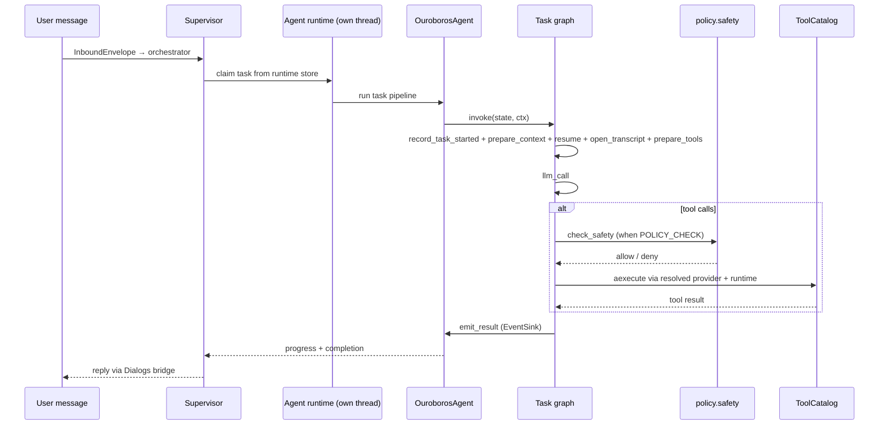

# Ouroboros — Architecture (headless runtime)

This document is the **current operational map** of the headless Ouroboros tree: package layout,
data flows, HTTP surface, policy boundaries, and rationale for non-obvious guards. It is not a
changelog.

**Target architecture:** production hardening, SberChat-first ingress, Secman, minimal sandbox,
and audit are specified in the wiki: [Solution Architecture](https://gitlab.k8s.genai.int/gen-ai/fusion_team/backend/ouroboros/-/wikis/Solution-Архитектура-As-Is).

---

## Runtime profile (this branch)

| Aspect | Current behavior |
|--------|------------------|
| Deploy env | `OUROBOROS_ENV=production` (default) or `development` for local work |
| Entry | `python -m ouroboros.app` (Docker package entrypoint on port 8080); `server.py` remains the composition module, not a direct launcher |
| User ingress / outbound | **Dialogs / SberChat** via `transport/dialogs/` (gRPC provider) |
| HTTP surface | Default: health + `/api/health` only (`gateway/router.py`). Optional browser ingress mounts extra routes when `BROWSER_INGRESS_ENABLED=true` |
| Configuration | **Environment + in-process `AppSettings`**; no `/api/settings`, no `settings.json` persistence in production |
| LLM provider | GigaChat B2Bank by default (`gigachat-b2bank::...` with mTLS cert paths); Cloud.ru Foundation Models via `cloudru::...` |
| Self-modification | **Removed** from tool surface: no `repo_write`, `repo_commit`, `run_shell`, git tools |
| Legacy browser UI | **`web/` removed**; browser-compatible HTTP/WS ingress is opt-in via `BROWSER_INGRESS_ENABLED` |
| Skill trust | `OUROBOROS_REPO_DIR/skills` is part of the trusted, read-only distribution; manifest capabilities/settings are auto-authorized |
| Marketplace install | **Removed** from HTTP routes; bundled skills under `skills/` only |

---

## High-level diagram (as implemented)

```mermaid
flowchart TB
    owner[Owner in Dialogs / SberChat]
    owner --> dialogs[Dialogs gRPC provider]
    dialogs --> bridge[LocalChatBridge / message_bus]
    bridge --> server[server.py Starlette + uvicorn]
    server --> sup[SupervisorLoop in supervisor/runtime.py]
    sup --> orch[TaskOrchestrator]
    orch --> store[Runtime DB store]
    server --> runtime[AgentRuntime in ouroboros/agent_runtime]
    runtime -->|claims| store
    runtime --> executor[TaskExecutor slots]
    executor --> agent[OuroborosAgent]
    executor -->|reports| seam[agent_events seam]
    seam --> sup
    agent --> graph[Task graph on new_core engine]
    graph --> catalog[ToolCatalog: ordered providers]
    catalog --> tools[Built-in tools + skills + extensions + MCP]
    agent --> memory[storage/memory + task_results]
    server --> gw[gateway: health]
    edge[Operator / probe] --> gw
```

The wiki describes the production target: SberChat adapter → identity gate → orchestrator →
policy engine → sandbox → Secman / resource gateways → audit. This repo already aligns on
headless server runtime and minimal public HTTP; user authentication is delegated to the ingress
front.

---

## Process model

Composition roots, each declaring the tier it serves: the **multi-user tiers**, each its own
process, and `server.py`, the single-process full runtime.

| Tier | Entrypoint |
|---|---|
| Browser transport | `python -m multiuser_config.transport.browser` |
| Supervisor | `python -m multiuser_config.supervisor` |
| Agent runtime | `python -m multiuser_config.agent_runtime.run` |
| Background memory | `python -m multiuser_config.background_memory.run` |
| Config registry | `python -m multiuser_config.config_registry` |

1. **`server.py`** — Starlette application, uvicorn lifespan, the full runtime's composition root.
   Starts `supervisor.runtime.run_supervisor` on one background thread and `AgentRuntime.execute`
   on another. It is the only module allowed to name both. No HTTP login gate; ingress auth is
   external.

2. **`supervisor/`** — `build_supervisor_runtime()` wires store, queue, orchestrator, state repo,
   and `LocalChatBridge` into one `SupervisorRuntime` (`runtime_context.py`). `TaskOrchestrator`
   (ingress SSOT), `TaskQueue`, typed `OwnerRuntimeState` / `RuntimeStateRepository`, runtime
   metadata DB, `message_bus`, Dialogs ingress, slash commands (`commands.py`), task timeouts.
   **Runs no task.** No module under `supervisor/` imports `ouroboros.agent` or
   `ouroboros.agent_runtime`, statically or lazily, and a test parses the import graph to keep it
   that way.

3. **`ouroboros/agent_runtime/`** — claims tasks and runs them: `AgentRuntime` (the claim loop),
   `TaskExecutor` (the slots and the drain), `AgentFactory` (one agent per run), `cancellation.py`,
   `identity.py`. Claims on its own schedule, stamps its own identity on every record, reaches
   supervisor state only through the store. Started on its own thread; nothing about how it is
   started assumes it shares a process with the supervisor.

4. **`background_memory/`** — the memory loop as its own component, asynchronous end to end and
   owning no thread: both roots run it as a task on the loop that owns its `AsyncEngine`, and it
   reaches the database only through its own repositories (`background_memory/infra/repositories/`).
   Resolves the consuming half of the memory-event seam. Each delivery is a task, at most one per
   ownership pair; consolidation is single-flight per ownership pair across every instance
   (`consolidation_leases` row). Imports neither `supervisor` nor `ouroboros.agent`.

5. **`multiuser_config/transport/browser/`** — browser transport as its own process. Composes
   routes, identity, store, gateway. Starts no supervisor and no agent. A test parses its import
   graph to keep `supervisor` and `ouroboros.agent*` out.

6. **`multiuser_config/config_registry/`** — config registry, owner settings, and chat registry as
   one process. Composes its routers on one async engine. Starts no supervisor, no agent, no
   tool catalogue. Like the transport root, it composes inline rather than through the shared
   component start-up, because that start-up refuses a process with no usable model provider.

Worker boot uses branch defaults `"headless"` / `"headless"`.

### Task record lifecycle

Ordinary task status writes use `SqlTaskRepository.update_task_status`; terminal states absorb
changes to a different status. Detached rows use separate conditional writes with current-lineage
and execution-lease predicates. The running body renews its own lease (`HEARTBEAT_PERIOD_SEC` = 30s);
supervisor heartbeat events only forward observability. Recovery is one atomic lineage transition
(`TaskQueue._recover_running`). Terminal reconciliation belongs to `SupervisorLoop`. The
soft-timeout notice is claimed on the record. The runtime store is composed once
(`runtime_persistence.initialize`); a starting runtime migrates nothing — `assert_schema_at_head` refuses to
start against a database below the required revision. Ending a running task is a cooperative
signal (`CancellationSignal`), not a cancelled future. A worker slot stays claimed until its thread stops.

`storage/tasks/` owns task lifecycle and terminal-memory markers; `storage/result_delivery/` owns publication claims and receipts.
`storage/create_root_task/CreateRootTaskUseCase` coordinates root admission and context capture through injected repositories.
`runtime_persistence.py` shares one transaction manager: owner checks, context reads and task insertion use one connection.
`RuntimePersistence` owns and closes the engine; schema checks take `Engine` directly. Module-local pools remain deferred.

Foreground root claims use `(owner_id, agent_id, surface_id, chat_id)`, enforced by the SQL claim
predicate and a partial unique index. All roots share the owner-wide running ceiling; detached
admission alone reads the active-job quota. `OUROBOROS_DURABLE_JOBS_ENABLED` gates new detached
admission. `supervisor/state.py` reads `/status` by the full chat key; unqualified `/stop` selects
that chat's job trees, while named job management authorizes the owner-and-agent pair.

---

## Package layout

```
server.py                     # HTTP entry, supervisor and runtime threads, the full runtime's root
multiuser_config/             # the multi-user tiers, one root each
  bootstrap.py                # the start-up every component process shares, in lifespan order
  <component>/dependencies.py # the swap point: what stops being in-process, and nothing else
  <component>/run.py          # the entry point: compose, install the stop signal, run, drain
supervisor/                   # ingress loop, orchestrator, queue, state, events — runs no task
  bootstrap.py                # build_supervisor_runtime (SSOT wiring)
  runtime_context.py          # SupervisorRuntime registry (process-local)
  orchestrator/               # TaskOrchestrator.submit
  runtime.py                  # SupervisorLoop + SupervisorContext
  queue.py                    # TaskQueue: enqueue, claim, the timeout and lease sweeps
  message_bus.py              # LocalChatBridge: the publishing boundary, and owner history
  events.py                   # one handler per kind of report a run publishes
transport/                    # user-facing transports; imports the seam, never the supervisor
  interfaces.py               # the seam: IInbox/IOutbox/IOutboxReader/IMessageGateway/ITaskStopNotifier/IEnvelopeBuilder
  infra/inmemory.py           # in-process backend behind the seam (the single-instance gateway)
  infra/redis_gateway.py      # Redis Streams backend behind the seam (queues that span processes)
  infra/kafka_gateway.py      # Kafka backend behind the seam (BROADCAST-only outbox)
  journal.py                  # the inbound journal replayed after a crash
  dialogs/                    # SberChat SDK: provider, updates loop, inbound DLP, cursor, delivery
  browser/                    # browser HTTP/WS adapters plus the contract SSOT (contracts.py)
  a2a/                        # A2A JSON-RPC server, executor, task store, response router
  skill_bridge.py             # in-process transport for extension skills
new_core/                     # active core migration target
  graph/                      # typed graph execution substrate (stdlib only)
  loop/                       # LLM-with-tools orchestration: nodes, routers, interfaces (stdlib only)
    transcript_merge.py       # shared OpenAI-shape transcript merge helpers
  llm/                        # LLMMessage / ToolCall wire types, usage accumulation (stdlib only)
  prompt/                     # prompt-section declarations, assemble/shrink/flatten (stdlib only)
  skills/                     # models, manifest, interfaces, catalog, surface, DI providers
  tools/                      # ToolCatalog, IToolProvider/ToolDescriptor, ToolContext, runtimes
    providers/                # builtin, skill, extension, mcp, a2a
ouroboros/
  app/                        # config facade, server_entrypoint, server_control, server_runtime
    broker_composition.py     # which broker backend a root composes, resolved from settings
  agent_events/               # the seam between a run and whoever consumes what it reports
    interfaces.py             # IAgentEventPublisher/IAgentEventConsumer + the frozen messages
    inmemory.py               # the in-process transport: publish blocks, droppable kinds drop
    codec.py                  # the wire format: kind beside payload, decode through the constructor
    redis_transport.py        # the multi-instance Redis transport: one stream, NOACK, delete on read
    kafka_transport.py        # the multi-instance Kafka transport: topics per scope, keyed by partition
  agent_runtime/              # claims tasks and runs them; the supervisor imports none of it
    runtime.py                # AgentRuntime: the claim loop and the drain
    bootstrap.py              # build_agent_runtime (SSOT wiring)
    executor.py               # TaskExecutor: the slots, the claim, the abandonment grace
    agent_factory.py          # one agent per run
    cancellation.py           # Event/Store/Composite CancellationSignal
    identity.py               # mint_runtime_id
  agent/                      # core, task_graph, loop adapters, context, task_pipeline, …
    task_graph.py             # whole-task graph assembly + initial tool-surface binding
    loop_adapters.py          # concrete implementations of the new_core/loop interfaces
    loop_tool_execution.py    # ToolCallExecutor — one round of tool calls end to end
    working_retrieval.py       # retrieval ranking and bounded prompt cards
    retrieval_index.py         # tool-agnostic compact indexing
    response_language_guard.py # final-answer script validation and one-shot repair
  gateway/                    # the mounted HTTP router and the default health surface
  ingress/                    # sberchat/ adapter stub
  egress/                     # outbound integrations (mirror of ingress/)
    a2a/                      # transports, connection, manager, dependencies, task_handles — calls out to remote A2A agents
    auth/                     # authenticators for MCP/A2A egress (moved from mcp/auth/)
  policy/                     # capabilities, tool_policy, safety, auth
  llm/                        # LLMClient facade, models (ModelRef SSOT), registry, providers/*
  tools/                      # tool modules, static policy table (catalog.py), dispatch gates, surface/events
  skills/                     # distribution filesystem/settings adapters, extensions and companions
  storage/                    # memory, chat_store, runtime store, task_results, settings/
    chat_store.py             # append/list owner messages (DB SSOT)
    runtime_models.py         # ConversationMessage, TaskRecord, OwnerRuntimeState, …
    conversation_format.py    # prompt/history formatting from ConversationMessage
    conversations/            # message/history/summary repository
    execution_memory/         # task episodes and tool invocation repository
    tasks/                    # task execution lifecycle, stop state and record encoding
    result_delivery/, create_root_task/  # publication receipts and root admission/context capture
    runtime_persistence.py    # engine/repository composition and lifetime
  contracts/                  # frozen application ABI: tool_context, plugin_api, …
  observability/              # health probes, pricing, event_bus, AEF tracing
  runtime_time.py             # timezone/locale SSOT shared by context, history, calendar
security_config/              # image-level MCP/A2A lists, header collector declaration (auth/), deployment prompt (PROMPT.md)
skills/                       # Trusted read-only distribution skill payloads
prompts/                      # SYSTEM.md, SAFETY.md
docs/                         # This documentation set
```

---

## Core: graph, loop, skills, tools (`new_core/`)

The per-task lifecycle runs as **one built graph** over a generic engine. `new_core/` is the
runtime-independent side of that, graph topology included; `ouroboros/agent/` holds the concrete
adapters.

| Package | Owns | Import rule |
|---------|------|-------------|
| `new_core/graph/` | Typed graph engine: nodes mutate one state object in place, topology is data, `build()` validates, `invoke` runs to `END` under `max_steps` | stdlib only |
| `new_core/loop/` | LLM-with-tools round: nodes, routers, `GraphContext`, `RunState`, ABC interfaces (with adapters, plus `CancellationSignal`) | stdlib + `new_core` only |
| `new_core/llm/` | `LLMMessage` / `ToolCall` wire types and `add_usage` | stdlib only |
| `new_core/prompt/` | Prompt-section declarations, assemble/shrink/flatten walk | stdlib only |
| `new_core/skills/` | skill models, manifest, `ISkillLoader` / `ISkillProvider`, `SkillCatalog`, `SkillSurface`, permission decisions, DI provider | imports no `ouroboros` or `transport` |
| `new_core/tools/` | `ToolCatalog`, `IToolProvider` / `ToolDescriptor`, `IToolRuntime`, `ToolContext`, `ToolSurface`, `ToolEvents` | **exempt** — may import `ouroboros` |

### Task graph topology

`build_task_graph` assembles it once per agent (`OuroborosAgent.__init__`); `handle_task` builds a
per-task `GraphContext` + `RunState` and calls `invoke` once:

```text
START → record_task_started → prepare_context → resume
resume            ─(router)─► «terminal» | confirm | open_transcript
open_transcript ─► prepare_tools ─► guard
guard             ─(router)─► round_limit_final | apply_overrides
apply_overrides ─► drain_inbox ─► checkpoint ─► prepare_transcript ─► llm_call
llm_call          ─(router)─► recover | confirm | finalize
recover           ─(router)─► «terminal» | confirm | finalize
confirm           ─(router)─► «terminal» | exec_tools
exec_tools        ─► guard
finalize          ─(router)─► «terminal»
round_limit_final ─(router)─► «terminal»
«terminal» = ctx.config.terminal → emit → END
```

Every node lives in `new_core/loop/nodes.py` and reaches its one effect through an interface. The
legacy `ouroboros/agent/loop.py` and `run_llm_loop` no longer exist.

### The loop interfaces and their adapters

Nodes reach the outside world only through ABCs on the immutable `GraphContext`
(`new_core/loop/interfaces.py`), implemented in `ouroboros/agent/loop_adapters.py`:

| Interface | Adapter | Responsibility |
|-----------|---------|----------------|
| `LLMProvider` | `LLMProviderAdapter` | model call with retry/usage, circuit reset, final-answer language repair |
| `ToolRunner` | `ToolRunnerAdapter` | `bind_surface`, `restore_surface`, `handle_tool_calls` / `process_tool_results`, `drain_overrides` |
| `TranscriptCompactor` | `TranscriptCompactorAdapter` | token/char estimation, microcompaction, LLM compaction, ledger note, cache seal |
| `ContextAssembler` | `ContextAssemblerAdapter` | `ToolContext` and opening transcript (prompt soft cap, memory recall, `build_llm_messages`) |
| `OwnerInbox` | `OwnerInboxAdapter` | injects owner messages that arrived mid-task |
| `EventSink` | `EventSinkAdapter` | progress, typing signal, tool live logs, `task_started`, `emit_result` |
| `ConfirmationBroker` | `ToolConfirmationBroker` | owner decisions for a round, parking/unparking, snapshot restore |

### Skill sources: provider, catalog, surface

`DistributionSkillProvider` over the trusted read-only distribution is the only `ISkillProvider`.
`SkillCatalog` combines providers in declared order, one process-wide object. `SkillSurface` is the
availability projection per task — in multi-user mode, narrowed by `OUROBOROS_USER_ENABLED_SKILL_IDS`
per owner+agent. Neither catalog refreshes on the task path. `CatalogSkillPermissionChecker`
verifies trusted distribution capabilities used by `SkillBridge`.

The owner-facing catalogue `GET /api/owner-settings/{agent_id}/skills` belongs to the config-registry
router. `server.py` and the config-registry root compose an unbound `SkillSurface` and its text
presentation snapshot at startup. `config_registry/user_settings/api/http/skills.py` projects agent
policy, saved selection and structured availability blockers into the HTTP payload.
`ouroboros/skills/presentation.py` loads optional names and descriptions from `agents/gigaagent.yaml`;
the frontend owns artwork keyed by skill id. The runtime serves no icon assets. Catalogue selection
and package-removal contracts are in
`openspec/changes/refine-browser-management-contracts/specs/tool-providers/spec.md`.

### Tool sources: one provider interface, one catalog

One `ToolCatalog` per process, wired in resolution order: `BuiltinToolProvider`,
`SkillToolProvider`, `ExtensionToolProvider`, `McpToolProvider`, `A2aToolProvider`. First provider
wins name collisions. The catalog holds no `ToolContext` — it is an argument on `execute`. Tool
surfaces: `surface="core"` enters first LLM request; `surface="discoverable"` is callable but
schemas enter only through `enable_tools` or `OUROBOROS_ENABLED_TOOLS`; `surface="excluded"` is not
exposed. Cross-cutting gates (excluded surface, safety supervisor) run once above providers in
`ouroboros/tools/dispatch.py`.

### Security context and per-call MCP credentials

`McpServerEntry.auth` is a union discriminated by `kind` (`McpAuthKind`):

| Kind | Declares | Transport | Authenticator |
|---|---|---|---|
| `none` (default) | nothing | either | `NoAuthenticator` |
| `user_headers` | `headers`, `cookies` from security context | `streamable_http` only | `UserHeadersAuthenticator` |
| `user_token` | `auth_header`; optional static `auth_token` | `streamable_http`; `sse` only with `auth_token` | `UserTokenAuthenticator` / `NoAuthenticator` |
| `mtls` | nothing — URL is the egress gateway | either | `NoAuthenticator` |

Security context (`infra/security_context/`) is keyed by `OwnerScope.security_token` (UUID5 over
owner+agent+surface). Collected at WebSocket handshake, stored encrypted in `security_contexts`
table. Personal MCP tokens stored in `mcp_user_tokens`, written only through `/api/owner-settings`.
`authenticator_for(entry, dependencies)` is the one mapping from entry to `IMcpAuthenticator`.

### Owner confirmation of a tool call

Whether the gate is active is the owner's setting (`OUROBOROS_TOOL_CONFIRMATION_ENABLED`), resolved
in `build_task_run` for the run's scope — at claim and again on resume — and handed to the executor;
`authorize_tool` takes the flag and reads no settings. Gated tool calls park the run (`waiting_confirmation`), store
`RunState.snapshot()` in `tool_confirmations`, and publish a question. The worker slot is free; the
question has no deadline. The owner's reply requeues the task; `resume` reads the snapshot back.
Decisions are spent per round (`spend_round_decisions`). A parked record with a snapshot and no open
request is queued by `reconcile_parked_tasks` in the supervisor tick.
`openspec/specs/tool-confirmation/spec.md` owns the behavior spec.

### Data identity: one scope, minted once

`OwnerScope` (`new_core/identity/owner_scope.py`) — frozen value with `owner_id`,
`agent_id`, `surface_id`, `chat_id`. Built once per message by the transport itself. No layer
re-derives it. `security_token` is a read-only property (UUID5 over owner+agent+surface).
`ServiceScope` is the identity of author-less work, built by `service_identity(job=…)`.

```text
transport  InboundEnvelope.scope   (chat_id / source are properties over it)
    ↓       TaskRequest.scope       → TaskRecord.input["scope"]
agent      RunConfig.scope         → RunState.scope
    ↓       ToolContext.scope       → every tool addresses through ctx.scope.*
```

### What a running tool sees

`ToolContext` (`new_core/tools/context.py`) carries `scope: OwnerScope`, `tool_surface:
ToolSurface`, `skill_surface: SkillSurface`, `events: ToolEvents`. No field is a queue. No
transport or registry is visible.

---

## Active new_core migration

`new_core/` is still a migration boundary, not its final home. The task path has landed: production
runs one built graph, the legacy loop entry is gone, LLM wire types moved down. What remains is
the pre-provider tool import shims and anything still duplicated across the seam. When the same
logic appears on both sides, the canonical body **moves down** into `new_core/` and `ouroboros`
imports it — no compatibility shim. `new_core/` stops being a migration boundary when the
deprecated import shims are gone and nothing on the seam is duplicated.

Migration owners: `new_core/graph/`, `new_core/loop/`, `new_core/llm/`, `new_core/prompt/`,
`new_core/skills/`, `new_core/tools/`, plus `ouroboros/agent/task_graph.py` and
`ouroboros/agent/loop_adapters.py`.

---

## Dependency Direction and Ownership

```text
app / gateway / ingress
          ↓
      supervisor
          ↓
        agent  ────►  new_core/graph, new_core/loop, new_core/llm
          ↓                     (never import back)
llm / tools / policy / storage
          ↑
    new_core/tools (migration exemption)
```

- Boundaries own transport/parsing, `supervisor` composition and lifecycle, `agent`
  task/context/memory orchestration, and lower layers provider/tool/policy/storage details.
- `new_core/graph`, `new_core/loop`, `new_core/llm`, and `new_core/skills` depend on no application
  package. The loop is reached through ABC interfaces implemented in
  `ouroboros/agent/loop_adapters.py`; skill filesystem/settings/extension effects arrive through
  injected values and interfaces. `new_core/tools` is the one deliberate migration exception and
  may import `ouroboros`.
- `observability` receives bounded events/context, not runtime state. Existing legacy reverse imports into `supervisor` are debt; replace them with narrow events, runtime ports, or storage contracts.

### LLM providers (`ouroboros/llm/`)

`LLMClient` facade (`client.py`) delegates to `ProviderRegistry` (`registry.py`). Model IDs parsed
in `models.py` (`ModelRef`, `parse_model_ref`, `qualify`). Wire types (`LLMMessage`, `ToolCall`,
`add_usage`) live in `new_core/llm/`.

| Adapter | Module | Model prefix | Transport |
|---------|--------|---------------|-----------|
| GigaChat B2Bank | `providers/gigachat_b2bank.py` | `gigachat-b2bank::` | httpx mTLS REST; v1 or non-stream v2 chat |
| Cloud.ru Foundation Models | `providers/openai_compat.py` | `cloudru::` | OpenAI-compatible SDK |
| Self-hosted | `providers/openai_compat.py` | plain model ID when `SELFHOSTED_LLM_BASE_URL` set | OpenAI-compatible SDK |

Two call paths, one set of decisions: `chat_with_fallback` and `async_chat_with_fallback` are thin
wrappers around `_route_with_fallback`, so candidate order, the shared deadline, circuit state,
failure classification and token accounting are written once. Only the transport and the waiting
differ (`LLMClient.async_chat`, `ProviderAdapter.async_chat`, per-call async clients, the
`MODEL_CALLS` slot taken through `IConcurrencyBudget.acquire_async`).

### Gateway boundary (headless)

| Method | Path | Purpose |
|--------|------|---------|
| GET | `/start` | Whether the start is over, and never a failure after it |
| GET | `/ready` | This process's own composition, the loop it hosts, and the database it composed |
| GET | `/live` | Vital parts of this process once started; unconditional before that |
| GET | `/api/health` | Redacted operational health |

Not mounted by default: `/`, `/ws`, `/api/settings`, file browser, marketplace install, MCP,
git/update, extensions HTTP, local model, chat upload. When `BROWSER_INGRESS_ENABLED=true`,
optional browser routes mount from `transport/browser/router.py`. `transport/browser/contracts.py`
is the SSOT for the optional browser HTTP/WebSocket payloads.

Browser job list, detail and stop routes remain mounted when detached admission is disabled. Both
composition roots publish `app.state.detached_enabled` and `task_stop_notifier`; the list returns
active foreground and background root jobs with their surface/chat identity and the composed flag.

`POST /api/jobs/{job_id}/stop` passes through the durable stop and executor notification owners;
`notify_chat` controls the synthetic inbox submission that generates the chat receipt. Its contract
is in `openspec/changes/refine-browser-management-contracts/specs/run-addressing/spec.md`.

### Transport seam

`transport/interfaces.py` declares the boundary between user-facing transports and the supervisor.
Dependency runs transport → seam ← supervisor: a transport imports the seam and shared
infrastructure, never `supervisor`.

- **Shape:** `IInbox.submit(InboundEnvelope)` inbound; `IOutbox.publish(OutboundMessage)` plus
  `IOutbox.reader(name, mode)` → `IOutboxReader.poll/ack/nack/defer/close` outbound. `IMessageGateway` composes
  both and exposes native `asubmit`/`apublish` plus `aclose` for async transports. The blocking
  reader remains on a thread. `ITaskStopNotifier` and `IEnvelopeBuilder` complete the seam.
- **Identity:** `InboundEnvelope.scope` is a required `OwnerScope`, built by the transport. Outbound
  carries scope **and** a delivery `source` as separate fields (a message may leave through `sberchat`
  while belonging to the `dialogs` surface).
- **Serialization:** `transport/codec.py` is the one wire format. Decode reconstructs through
  constructors so validation re-runs on the receiving side. `ensure_wire_safe` runs at
  `submit`/`publish` on every backend.
- **Filtering is on the transport side, never in the queue.** A non-matching message is `ack` +
  drop, never `nack`.
- **Deferred delivery:** outbox readers preserve `(owner_id, agent_id)` order while another owner
  progresses; the receipt carries the message’s failed-attempt count. Redis keeps pending order
  and retry deadlines beside its consumer group, bounded by stream retention. Kafka BROADCAST
  and the single-instance backend use subscription queues in `transport/infra/pending.py`.
- **Subscription modes:** `SHARED` (competing consumers, durable backlog) and `BROADCAST` (one
  per instance, from present).
- **Backends:** `transport/infra/inmemory.py` (single-instance),
  `transport/infra/redis_gateway.py` (Redis Streams, spans processes), and
  `transport/infra/kafka_gateway.py` (Kafka, BROADCAST-only outbox). Resolved by
  `ouroboros/app/broker_composition.py` from `OUROBOROS_BROKER_BACKEND`. The agent-event seam and
  memory-event seam share the same backends and selector. Kafka connection lives in
  `infra/kafka_client.py`, which builds clients of both libraries: kafka-python for every producer,
  the synchronous group consumer and the partition reader, aiokafka for the one asynchronous group
  consumer background memory reads its events with.
- **Journal:** a transport persists the user's message with `inbound_processed: False` before
  submitting. `transport/journal.py` replays what a crash left unprocessed, deployment-wide.
- **Deployment keyspace:** under multi-user mode, the resolved object keyspace is recorded once in
  `deployment_keyspace`; every later start compares and refuses on a difference.

### Ingress

- **Primary:** `transport/dialogs/` polls Dialogs → `InboundEnvelope` → inbox →
  `TaskOrchestrator.submit`. `provider.py` owns SDK lifecycle, `inbound.py` owns bounded
  DLP/ingress work, and `outbound.py` owns text, presence, and media delivery.
- **A2A:** `transport/a2a/executor.py` submits through the seam's inbox (`source=a2a`) and
  persists the incoming message before `submit`. One delivery id keys both the row and the
  envelope's `client_message_id`.
- **A2A discovery metadata:** `transport/a2a/server.py` uses configured agent name and
  description, falling back to `ГигаАгент` and `Personal AI agent`. Building the card
  and starting the server require no durable-memory read.
- **Browser:** `transport/browser/*` when `BROWSER_INGRESS_ENABLED=true`. Identity resolved per
  connection/request through `IBrowserIdentity` (`ConfiguredOwnerIdentity` or
  `TrustedHeaderIdentity`).
- **Skills (bridge):** `transport/skill_bridge.py` — in-process `PluginAPI.inject_chat` /
  `send_message`.
- **Trace correlation:** every ingress establishes `X-Trace-Id` (accepting the caller's when its
  protocol carries one, originating when it does not). The canonical dashed UUID form reaches every
  consumer. The identifier crosses as data on every thread hand-off, never as ambient context. Six
  hand-off sites: transport→supervisor, supervisor→dialogs delivery, HTTP→A2A executor, dialogs
  ingress→workers, task thread→background memory, agent thread→lifespan loop.

### Egress

- **A2A:** `ouroboros/egress/a2a/` — turns configured remote A2A agents into tools. One tool per
  agent, plus `a2a_task_status` and `a2a_task_cancel`. Task lifecycle with polling; deadlines nest.
- **WorkStation:** `ouroboros/egress/workstation/` — AEF WorkStation sandbox client. Six tools:
  `workstation_connect`, `code_exec`, `file_read`, `file_write`, `file_edit`, `apply_patch`. One
  session per owner+chat+agent. `WORKSTATION_BASE_URL` gates the surface.
- Every outbound HTTP call carries `X-Trace-Id` and `X-Agent-Id`, per request, never merged in at
  construction. S3 stamps after SigV4 signing.

---

## Agent loop and tools



**Tool catalog and selection** (`tools/catalog.py`, `agent/task_graph.py`): built-in tool metadata
declared as `ToolSpec`, reaches runtime as `ToolDescriptor` from `BuiltinToolProvider`. Per-task
prompt surface assembled by `bind_tool_surface` in the `prepare_tools` node.

**Scheduler:** `ouroboros/scheduling` stores owner-scoped rows in the runtime DB (`schedules` +
`schedule_runs`). Dispatch runs as a supervisor worker thread on every replica;
`(schedule_id, slot_id)` receipt claim keeps delivery at-most-once. Every lifecycle read/write is
narrowed to the caller's owner, agent **and conversation**. An injected task is detached wherever
durable jobs are on. Browser listing and deletion in `transport/browser/schedules.py` use a
`SchedulerService` composed by `server.py` or the browser transport root, passed through app state
and called off the event loop. Orphan receipt settlement belongs to the existing periodic receipt
sweep alongside retention, not the due-slot claim pass; PostgreSQL skips locked orphan receipts.
The browser and deletion contracts are in
`openspec/changes/refine-browser-management-contracts/specs/schedule-addressing/spec.md`.

---

## Data layout

Revision `0020` removes durable identity. Revision `0021` adds task surface/chat columns, the foreground
chat index, and scratchpad chat partitions. With writers stopped, it preserves foreground blocks with
one recoverable human chat per owner and agent; missing or ambiguous identity resets only that buffer.
Detached blocks stay intact. Unreadable task identity or an unavailable key aborts before mutation.
All changes share one transaction. Coordinated rollout/rollback: `docs/DEVELOPMENT.md` §Operational entrypoints.

Persistence layers (no PVC in production Kubernetes):

| Layer | Production | Development |
|-------|------------|-------------|
| **Runtime metadata** | PostgreSQL (`OUROBOROS_RUNTIME_DB_URL` or `_1..N` failover); a process with none configured refuses to start | Same, and the same refusal |
| **Object storage** | S3-compatible (`OUROBOROS_S3_BUCKET`) | Same |
| **Ephemeral pod disk** | emptyDir: locks, per-task workspaces, skill subprocess cwd — transient only | Same transient set |

**StorageProvider scopes** (`ouroboros/storage/blob/`): keys are
`tenants/{tenant_id}[/{S3_PREFIX}]/{scope}/…` in S3. Under `OUROBOROS_MULTIUSER` only, `uploads/`
inserts `owners/{owner_seg}/agents/{agent_seg}/` below the scope. Every call takes two scopes that
never merge: `owner_scope` (identity) and `scope` (storage scope).

| Scope | Contents |
|-------|----------|
| `memory/` | No writer through the provider; durable memory is the runtime DB table `memory` |
| `state/` | Private extension state (owner runtime state is in DB `owner_runtime_state`) |
| `uploads/` | Ingress attachments. Under multi-user, owner-keyed |
| `a2a_tasks/` | No writer through the provider; A2A task rows live in the runtime DB |

**Runtime DB tables:**

| Table | Keyed on | Notes |
|-------|----------|-------|
| `messages` | `(owner_id, agent_id, chat_id)` + surrogate PK | Owner-visible dialogue. `chat_history_visible` and `inbound_unprocessed` are indexed derived columns. `content` encrypted when chat encryption is configured. |
| `context_summaries` | `(owner_id, agent_id, chat_id)` | One summary per conversation; `source_offsets_ref` is the committed raw-message cursor. |
| `tasks` | `(owner_id, job_id, lineage_ordinal)` | Canonical `surface_id`/`chat_id` from `OwnerScope`; foreground root uniqueness uses the full chat key. Successors advance lineage. |
| `tool_confirmations` | all `OwnerScope` axes + `(task_id, round_idx)` | Parked run state. Partial unique index on pending rows = one-open-request-per-scope. |
| `owner_runtime_state` | `(owner_id, agent_id)` | Owner claim, session id, spend counters. |
| `memory` | `(owner_id, agent_id, name)` | Every durable memory. `kind` is a closed enum. |
| `scratchpad_blocks` | Full chat key for ordinary work; `(owner_id, agent_id, job_id)` for detached work | Working-memory blocks. FIFO at `SCRATCHPAD_MAX_BLOCKS=10` per partition. |
| `task_episodes` | all `OwnerScope` axes | Successful task summaries for working retrieval. |
| `tool_invocations` | all `OwnerScope` axes, read by `task_id` | Bounded tool-call summaries. |
| `llm_usage` | `(owner_id, agent_id)` | Token usage counters. |
| `audit_events` | `(owner_id, agent_id)` | Event journal (`log_stream` column distinguishes streams). |
| `agents` | `(owner_id, agent_id)` | One row per agent an owner has. Core agent id is reserved `main`. |
| `user_settings` | `(owner_id, agent_id, key)` | Owner-changeable keys per agent. Sparse: no row = instance value. |
| `chats` | `(owner_id, agent_id, chat_id)` | Conversation records. Title encrypted. Born on first message. |
| `security_contexts` | `(security_token, param_type, param_name)` | Collected security parameters. Value encrypted. |
| `mcp_user_tokens` | `(mcp_server_id, owner_id, agent_id)` | Personal MCP tokens. Token encrypted. |
| `schedules` / `schedule_runs` | `(owner_id, agent_id, chat_id)` | Owner-scoped schedule rows + dispatch receipts. |
| `consolidation_leases` | `(owner_id, agent_id)` | Single-flight consolidation guard + failure throttle. |
| `deployment_keyspace` | single row | Object keyspace agreement under multi-user mode. |
| `files` / `folders` / `message_files` | `(owner_id, agent_id)` | File catalog, folder hierarchy and links to messages; SQL owns metadata and cleanup claims. |

### User files (runtime DB + S3)

`ouroboros/storage/file_catalog.py` owns scoped file/folder mutations, message links, artifact aliases and cleanup claims. `file_history.py` owns file-to-message views; `chat_store.py` builds
messages, reads bounded conversation history and atomically commits inbound messages, file links and browser chat registration through `InboundMessageStore`, composed by the process roots. S3
stores immutable content only. `transport/browser/files.py` exposes `/api/files*` and `/api/folders*` alongside the chat upload URLs.

Process roots own one native async S3 file client and pass its loop to synchronous producers. `blob/async_backend.py` streams browser I/O; `chat_attachments.py` stages and publishes content.
`attachment_validation.py` shares validation across storage, tools and transports; allowed formats come from `security_config/attachments.py`. `ouroboros/attachment_parser.py` is its isolated
child process entrypoint, with no application-service imports. `file_transfers.py` bounds process/owner admission through limits composed once at startup, including reserved browser output
capacity. Consumers drain before the roots close these clients; a failed drain retains their resources.

Tools share catalog reachability through `tools/attachments.py`. `tools/service/artifacts.py` owns immutable task publication and fingerprint-checked workspace references; the outbox carries
`StoredFile` identity until the receiving transport reads its bytes. Legacy JSON metadata is read only by the explicit `ouroboros file-catalog-backfill` operator command.

### Owner chat messages (runtime DB)

Owner-visible dialogue is stored in the `messages` table via `ouroboros/storage/chat_store.py`. `conversations/` owns its SQL plus context summaries and handoff persistence. `runtime_persistence.py`
composes it with the task store and one transaction manager. Admission binds its active connection for context reads; the task store retains commit ownership. Browser history and
background-memory repositories keep their consumer-owned SQL implementations. Every scoped read takes an `OwnerScope` and filters on owner, agent and chat together. `actor_type`: `owner`,
`agent`, `system`. A negative `chat_id` is a routing fact (skill bridge: `[-3999, -1]`, A2A: below `-4000`). After any chat message is appended, `supervisor/message_bus.py` publishes a
`ChatMessagePersistedEvent` for background memory.

### Working retrieval (runtime DB)

Successful tool calls → `ToolInvocation` summaries. Successful tasks → `TaskEpisode` summaries.
`agent/retrieval_index.py` and `agent/working_retrieval.py` own indexing and prompt retrieval. Both
tables carry all `OwnerScope` axes. Expired rows removed by supervisor at configured interval.
`storage/execution_memory/` groups episode and invocation reads/writes in one repository, composed
with conversations and the task store by `runtime_persistence.py`. Admission binds its connection for
snapshot reads; explicit repository transactions share that connection and nest via savepoints.
The agent receives this repository for tool recording, episode enrichment and prompt retrieval.
Supervisor terminal-memory publishing receives it independently; retention cleanup keeps its own SQL.
Module-local database connections remain deferred; future composition roots own their transaction
managers, and no cross-process transaction is implied by today's shared schema.

### Owner confirmations (runtime DB)

The owning Alembic revision creates `tool_confirmations`: one row per gated tool call, carrying all
`OwnerScope` axes, the task and tool, the call identity (`round_idx`, `call_ordinal`, `args_hash`),
the parked run's state (`run_state_json`), `status`, and created/decided/spent stamps. A partial
unique index over the axes, covering `pending` rows only, is the one-open-request-per-scope
rule.

### Durable memory (one table in the runtime DB)

`ouroboros/storage/core_memory/memory/` — `memory` table, unique on `(owner_id, agent_id, name)`.
`kind` is a closed enum with per-kind policy:

| kind | injection | capacity |
|---|---|---|
| `user` | `recall_auto` | 20 |
| `feedback` | `recall_auto` | 30 |
| `project` | `recall_selector` | 100 |
| `reference` | `recall_selector` | 40 |
| `knowledge` | `index_only` | 100 |

Every kind supports writes, append, overwrite, and deletion. Prompt assembly keeps the base prompt,
skills, and nonempty memory/knowledge indexes in cacheable prefixes; scratchpad and other runtime
sections are volatile. No durable self-description, its body block, or empty cache prefix remains.
`prompts/SYSTEM.md` owns standing instructions; runtime sections and tool descriptions own current
capabilities. No environment-profile document is generated or read; leftover `memory/WORLD.md`
objects are inert.

**Distillation** (`background_memory/`): background memory work, not a
supervisor task. Published by `EventSinkAdapter.emit_result` after `completed` tasks. Restricted to
`project`/`reference` kinds. **Consolidation** (`background_memory/`): shared-chat summary.
Single-flight per `(owner, agent)` across every instance. Thresholds: 25k estimated tokens or 100
messages.

### Scratchpad (working memory in the runtime DB)

`scratchpad_blocks` table, one row per block, ordered by database-assigned autoincrement `id`. FIFO
at `SCRATCHPAD_MAX_BLOCKS=10` active blocks per partition. Ordinary work uses the full chat key with
empty `job_id`; detached work uses `(owner_id, agent_id, job_id)` with empty surface/chat columns.
The scratchpad domain service owns append, replacement, reads and eviction within that partition;
named long-term memory remains shared by owner and agent. Overflow sets
`status='evicted'`. The insert and eviction are one transaction. `data_read("memory/scratchpad.md")`
is refused and names `update_scratchpad`.

---

## Configuration

**SSOT:** `ouroboros/storage/settings/schema.py` (`AppSettings`), materialized once at startup via
`ouroboros/storage/settings/bootstrap.py`. `app/config.py` is startup wiring and a legacy facade.
Runtime reads return the existing object without I/O.

**Bootstrap-only I/O:** `os.environ` and `OUROBOROS_SECRETS_DIR/{KEY}` files read only inside
`bootstrap_config()`. Runtime code must not call `os.environ.get` for Ouroboros settings.

**Load order:** (1) optional poll for secrets mount; (2) schema defaults; (3) OS environment; (4)
secret files (**files override env**); (5) in-memory overlay; (6) production overlay.

**External server lists:** MCP servers (`security_config/mcp.py`) and A2A agents
(`security_config/a2a.py`) are image-level, not runtime settings. `OUROBOROS_USER_ENABLED_MCP_IDS`
is an owner+agent setting. `MCP_ENABLED` / `A2A_EGRESS_ENABLED` are runtime kill switches above.

**User settings:** keys an owner may change per agent, keyed on `(owner_id, agent_id, key)` in
the sparse `user_settings` table. Written only through `/api/owner-settings`. Absence means the
instance value applies.

**Personal MCP tokens:** under the same `/api/owner-settings` prefix. Never returned. Written by
`SqlUserTokenRepo`, read by `SqlUserTokenStore`.

**Secrets:** `SecretStr` fields for certs, bot tokens, API keys. Values from OS env or per-key
files under `OUROBOROS_SECRETS_DIR`.

---

## Observability

| Surface | Status |
|---------|--------|
| `/start`, `/ready`, `/live` | Every process |
| `/api/health` | Default headless gateway |
| `/api/state` | Optional browser ingress only; reports caller's queue counts and spend |
| LLM usage counters | Supervisor runtime state + `observability/pricing.py` |
| AEF tracing | Optional via `AEF_TRACING_ENABLED`; emits masked spans, propagates `X-Trace-Id` |

Readiness consults the runtime database and nothing else outside the process. AEF tracing is off by
default; trace ID propagated across all boundaries. `AGENT_SYSTEM_CONFIGURATION` Kafka event
publishes tool catalog inventory at startup from `server.py` and agent-runtime tier only.

**LLM middlewares:** `LLMProvider` declares `middlewares: Sequence[LLMMiddleware]`.
`ouroboros/policy/llm_middlewares.py` lists factories; `build_task_run` calls each once per task.
The list does not live in `security_config/` — replacing deployment config must not change safety
middleware.

**AEF Guardrails:** `GuardrailsMiddleware` is the first middleware. Every call passes through it,
but only dialogue boundaries reach the GR `/check-only` endpoint. Observed, never enforced. Off by
default; configured via `GR_*` settings.

---

## Frozen contracts

`ouroboros/contracts/` pins skill manifests, `ToolContextProtocol` (including the `events` channel
a tool reports through), `PluginAPI`, chat id policy, the runtime-command vocabulary
(`chat_commands.py`, shared because a transport may not import the supervisor), task constraints,
the type-generic wire helpers both seam codecs use (`wire.py`), and the Redis reply shapes every
broker backend reads (`stream_replies.py` — plus `BrokerOutage`, the one policy here rather than a
shape). Browser TypedDicts live in `transport/browser/contracts.py`. Extend only with tests in
`tests/ouroboros/contracts/test_contracts.py`.

---

## Key invariants

The invariants live in **`docs/INVARIANTS.md`** — one short file, so that checking them
never means paging through this one. `AGENTS.md` routes there too. Do not restate them here: a
second copy is a second source of truth, and the stale copy is the one that gets believed.
